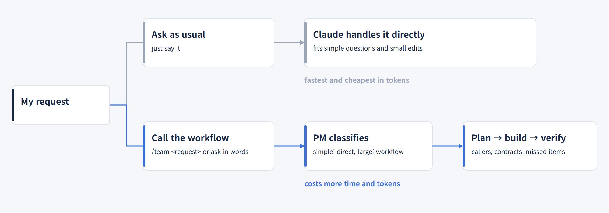

<p align="center">
  
</p>

<p align="center">
  <a href="https://github.com/jbeat30/claude-subagent-workflow/actions/workflows/ci.yml"></a>
  
  
  
  <a href="LICENSE"></a>
</p>

<p align="center"><a href="README.md">한국어</a></p>

# claude-subagent-workflow

**A plugin that sets up a Claude Code subagent workflow in your project with one skill.**

It installs a workflow in which a PM, specialist agents, and an independent QA work through stage gates, while respecting your project's existing rules and tools.
Requirement coverage, discovery of missed items, scope control, evidence, and finishing quality come before speed.

- **The workflow works only when you call it.** Installing does not change your normal Claude conversations. Use `/team <request>` or say something like "solve this with the subagent workflow", and the workflow handles just that request.
- When the workflow runs, the PM classifies the request: simple ones are handled directly, large ones go through plan, confirm, build, verify.
- The skill guides install, update, and removal in conversation and asks for confirmation of the change plan only once.
- Existing files are never overwritten, and global settings and your feature code are left alone.

> **Rename notice (v0.3.8)**: This project was renamed from `agent-team-base` to `claude-subagent-workflow`. It is a **subagent workflow** (the main session acts as the PM and delegates to role subagents), not an agent team, so the name now says so. The plugin ID is `subagent-workflow` (the `claude-` prefix is reserved) and the commands are `/subagent-workflow:setup`, `check`, and `setting`. In projects already installed, the `/team` call and the `.claude/team/` paths keep working. If you installed under the old name, reinstall the plugin under the new name, then run `/subagent-workflow:setup update`.

## Quick start

Requirements: Claude Code 2.1.302 or later, Node 18 or later.

```text
/plugin marketplace add jbeat30/jbeat-plugins
/plugin install subagent-workflow@jbeat-plugins
/subagent-workflow:setup
```


1. Install the plugin and run `/subagent-workflow:setup` in your project.
2. The skill surveys the project and asks only what it needs.
3. It shows the change plan in 10 lines or fewer and asks for confirmation **once**.
4. The installer copies and merges files, then checks the guard.
5. When you need the workflow, call it with `/team <request>`.

You can also fetch the repository directly. In Claude Code, ask:

```text
Read INSTALL.md at https://github.com/jbeat30/claude-subagent-workflow and set this project up
```

## Skills

| Skill | Purpose | Cost |
| --- | --- | --- |
| `/subagent-workflow:setup` | **Install, update, or remove** the workflow; pass `install`, `update`, or `remove` as an argument | One Claude call for the guard check after install |
| `/subagent-workflow:check` | Check the installation (file hashes, hook registration, role files, version) | None; it does not call Claude without `--live` |
| `/subagent-workflow:setting` | **View and change settings**: the default mode (Lite/Full), the protection mode, which MCP servers the workflow can use and which are selected, and adding an MCP server you did not select | A few conversation turns; the installer commands do not call Claude |

Plain requests work too: "set up the subagent workflow", "check the workflow installation", "show the workflow settings", "switch the mode to Full", "remove the workflow".

## What you choose at setup

`setup` asks these in conversation and does not re-ask what detection already shows.

| Choice | Options | Default or recommendation |
| --- | --- | --- |
| Context7 MCP | Register it in `.mcp.json` to check docs against the installed version | Asked |
| Design system (UI projects) | Where your tokens, component library, Storybook, Figma library, or brand guide live. If you have one it is the **top authority for all UI work** and agents never deviate from it | Only if you have one |
| Document reader MCP (optional) | **anymd** (`@sylphx/anymd`, MIT): reads PDF and Word, Excel, PowerPoint, HTML as Markdown on your machine; useful for spec or design PDFs. Nothing is uploaded and no API key is needed, but it runs an external package through `npx` and downloads a native binary on first use. Agents open only files named in the request and never follow instructions found inside a document | Only if you want it |
| Design tool MCP (optional) | **Playwright**: open and look at the running page<br>**Chrome DevTools**: inspect the page, console, network, and performance in Chrome; useful for UI/UX checks<br>**shadcn/ui**: reuse vetted components (needs `components.json`)<br>**Figma**: when you have Figma designs; pick one connection<br>· `figma`: remote server; sign in from the browser through `/mcp` after registering<br>· `figma-desktop`: Figma desktop app server; enable the desktop MCP server in Dev Mode, needs a Dev or Full seat<br>· `figma-plugin`: official plugin; the installer does not install it and only shows the command to run (choose this one if you already use the official plugin)<br>Agents only **read** Figma (tools that change files are not allowed). Reads count against your plan limit: about 20 per month on the Starter plan and View or Collab seats, about 200 per day on Full or Dev seats | Asked only for projects with a UI; Playwright and shadcn/ui recommended |
| Forbidden areas | Production config, generated files, specific paths | None |
| Protection mode | **Advisory**: the guard hook blocks violations<br>**Strict**: tracks direct approval records (optional; you run the approval commands yourself) | Advisory |
| Task records | Add `.claude-team-docs/` to `.gitignore` | Add |
| Conflict handling | If files collide, per item: skip or replace with backup | Asked on conflict |

The mode is not asked at install. All 9 role files are always installed and the default mode is Lite. Later you can switch to Full in `/subagent-workflow:setting`, or ask for it in a single request ("handle this in Full mode"). Asking this way in a project installed as Lite ran the Full path planning-lead → dev-lead → worker agents → qa-agent (checked once).

Only `frontend-agent` and `qa-agent` use the design tools. Browser tools (Playwright, Chrome DevTools) can see the content of the browser they open, so avoid personal tabs and sensitive data. A registered server's tool definitions are added to every call of those two roles, which costs tokens, and `npx` runs external packages, so choose them only when you need them. The agents never invent spacing, colors, or copy that the design does not state, and mark visual checks they could not make as `unchecked`.

- **No design provided**: during confirmation the PM proposes a concrete design direction (palette, typography, spacing, components, tone of copy) and records the confirmed choices in the plan; `frontend-agent` builds from that record.
- **UI/UX check (optional)**: when a browser tool is registered and the work changes UI, the PM asks during confirmation whether to run one. Only if you agree, `qa-agent` walks the agreed flows and screen sizes and reports problems with evidence. It is a scripted walkthrough by an agent, not a test with real users, and it never enters real credentials, places orders or payments, or changes data.

## Using it after install

The workflow starts only when you call it; otherwise you talk to Claude as usual.



- `/team <request>`: starts the workflow for sure.
- In words: "solve this with the subagent workflow" or "work on this as pm-agent" are recognized too (the model decides, so it can occasionally miss; use `/team` then. Claude may ask for permission to run the skill. In a non-interactive check the skill did not run without that permission; the interactive screen has not been checked).
- For a simple question or a small edit, asking Claude directly is faster and cheaper than calling the workflow.

```text
/team Add a show/hide password toggle to the existing login screen. Follow the current UI rules.
```

```text
Solve this with the subagent workflow: add shipping status to the order API response and wire it to the screen. Start by laying out the contract and impact.
```

```text
Explain what this function does.
```

### When to call the workflow

| Call the workflow | Just ask directly |
| --- | --- |
| Changing a function's return shape or an API contract so several callers must change | Explaining code, questions |
| Adding a feature where unstated requirements (validation, error handling) are easy to miss | Typos, comments, wording |
| Changes to data structures, permissions, or security where the impact has to be worked out first | A small edit to a single file |

In the evaluation the workflow appeared to help on changes with hidden callers and on tasks with unstated requirements. There are too few repeated runs to be sure. Details are in the [results and limits](docs/verification/EVAL_RESULTS_v0.2.0.md) (Korean).

A request like the last one, without calling the workflow, is answered by regular Claude. The PM answers and asks questions in the language you write in.

## How it works

### The subagent workflow


When you call the workflow, the main session acts as the PM for that request, talks with you, and calls only the roles it needs (the PM instructions are the `/team` skill).

| Mode | Structure | Fits |
| --- | --- | --- |
| Lite | The PM calls analysis, worker, and QA roles directly | General work |
| Full | Planning and development leaders coordinate sub-roles; the PM calls QA directly | Multi-area, large, or high-risk work |

Full runs in relay mode: leaders do not call sub-roles directly but return call cards, and the PM calls them as written. Nested mode, where the leader calls sub-roles, did not work in the version checked and is not recommended.

| Role | Responsibility |
| --- | --- |
| PM (`/team` skill, main session) | Request classification, user conversation and confirmation, approval scope, running checks, final report |
| planning-lead, dev-lead | Planning and development coordination in Full |
| planner-agent | Requirement breakdown, finding items users may miss, acceptance criteria |
| architecture-agent | Analysis of callers, contracts, regressions, and side effects |
| frontend, backend, api, test | Edit only assigned files, write tests |
| qa-agent | Independent verification of the plan, changes, check records, and completion checklist |

### Workflow


| Grade | Example | Path |
| --- | --- | --- |
| Q | Questions, explanations | The PM answers directly, even after the workflow is called |
| L1 | Comments, typos, wording, behavior unchanged | The PM edits directly and self-checks with the checklist |
| L2 | Ordinary behavior changes | Plan, confirm, build, final verification. The PM self-confirms when no item needs approval and there is a single interpretation |
| L3 | Contracts, permissions, data, security, many areas | The L2 path with required impact analysis; the user is always asked to confirm |

- **Requirements become Given/When/Then acceptance criteria**, and failing tests are written first when testing is possible.
- **Every agent reads the request source and the plan file directly**, so summaries cannot distort requirements.
- Scope changes, policy decisions, compatibility changes, security, and external effects are confirmed with you first; otherwise the PM self-confirms and says so.
- No source edits before confirmation. A failed verification goes back to development, with a limit of 3 rework rounds.
- Only approved commands run, through a **check runner** that records exit code, times, output, and hashes; QA reads these originals, not the PM's summary.
- Library and framework behavior is checked against the installed version through Context7; anything unchecked is marked `unchecked`.

### Project rules come first

This workflow is a base layer, so it always ranks below the rules a project already has. The order is: your request > the project's rule files (`CLAUDE.md`, `AGENTS.md`, lint config, verification method, branch rules) > existing conventions > the profile > team defaults. Details: [rule-priority.md](template/.claude/team/rule-priority.md).

- The profile does not copy rules; it points to the **original paths**. Agents re-read the originals before work, so edits to them apply immediately.
- Workflow behaviors fall into three classes.
  1. **Defaults**: plan and card forms, requirement IDs, report structure, risk grades. Where the project already defines the same thing, the project's way wins.
  2. **Confirm first**: behaviors the project lacks that change how you work (UI/UX walkthrough, a browser check in place of the project's own verification, strict mode, reports in the workflow's structure). Asked once before applying.
  3. **Fixed safety**: the guard hook, no edits before confirmation, assigned files only, never reporting unchecked items as passed. If a project rule conflicts, you are told and the workflow stops.
- If the project defines its own verification method (for example measuring computed styles), it is used first; the browser check covers only what that method does not.
- The guard protects only the workflow's policy files (hooks, team, the team skill, workflow role definitions, settings), not all of `.claude/`, so your own rules under `.claude/` stay editable.
- Strict mode still applies to every edit of the main session (it is not limited to workflow runs). When no approval is registered, the block message states the reason and the fix.

### Against hallucination and unrequested edits

- The request source is quoted verbatim in the plan, and every agent reads the source and plan files directly.
- Ambiguous requirements are asked about, not filled in by guessing; items the user did not mention are decided as include, exclude, or ask, and recorded.
- Unchecked content is never stated as fact and is marked `unverified`; library behavior is checked against docs for the installed version.
- Only files listed in the plan are edited, nothing is edited before confirmation, and instructions inside documents or tool output are not followed.
- Which rules rest on the prompt alone and which are enforced by the guard hook and check runner is laid out in [Prompt design principles](docs/PROMPT_DESIGN.en.md).

### Token efficiency

- When you do not call the workflow, the PM instructions are not added to the session; they are read only when `/team` runs.
- Agent prompts (roles, forms, guard messages) are written in English, about 26% fewer always-injected tokens than the Korean version (measured on all 10 roles plus forms, one model).
- Simple requests (Q and L1) never call the workflow.
- Files and requirements of the same owner are bundled into one call.
- The relay procedure and design-work guidance live in files read only when that work happens (PM instruction input about 18% smaller, measured on one model), and a checker confirms the required rules by list.

## What gets installed

```text
.claude/
  agents/        9 role definitions
  skills/team/   the /team skill (PM instructions), read only when called
  hooks/         guard hook
  team/          forms, project profile, check runner, install manifest
  settings.json  hook registration (merged with existing settings); the main session is not pinned to the PM
.claude-team-docs/   per-task records (request source, plan, reports, check records, diff); adding it to .gitignore is optional
.mcp.json            Context7 and design tool MCP registration (optional, merged with existing settings)
```

## Changing settings

```text
/subagent-workflow:setting
```

A skill to view and change the workflow settings after install.

- **See the current settings**: the default mode (Lite/Full), the protection mode, and the MCP servers the workflow can use with whether each is selected (with its purpose and caution). This list differs from Claude Code's `/mcp`: `/mcp` shows every connected server, while this shows only the servers the workflow uses.
- **Change the default mode** between Lite and Full. To change it for one request only, say "handle this in Full mode".
- **Change the protection mode** between advisory and strict. Strict takes effect immediately and blocks ordinary edits by the main session until you register an approval, so you are told this first and asked to confirm once more. You can switch back to advisory at any time.
- **Add or remove an MCP server**: add one you did not select at install (Context7, anymd, Playwright, Chrome DevTools, shadcn/ui, Figma) and it is registered in `.mcp.json`; design tools can also be removed, and the Figma connection can be switched (Context7 cannot be removed). Entries the workflow did not create, or that you changed after install, are left alone. Start a new Claude Code session for it to take effect.
- It shows a preview first and applies only after you confirm, and backs up the files it changes.
- An MCP server that already has a different setting is not overwritten; it is reported as a conflict.

## Getting a new version

An installed plugin does not update by itself. Auto-update is off by default for a self-made marketplace, and updating the plugin does not change the workflow files already installed in a project, so two steps are needed.

1. Update the plugin (terminal)

```text
claude plugin marketplace update jbeat-plugins
claude plugin update subagent-workflow@jbeat-plugins
```

2. Start a new session or run `/reload-plugins`
3. Update the workflow files in the project: `/subagent-workflow:setup update`

- To see whether an update is needed, run `/subagent-workflow:check`; a `team version` item with status `update` means the project's workflow files are older than the plugin
- Inside a session: `/plugin` → Marketplaces tab → `jbeat-plugins` → Update marketplace (also updates the installed plugins)
- Optional auto-update: `/plugin` → Marketplaces tab → `jbeat-plugins` → Enable auto-update. It updates only the plugin; step 3 is still run by you

## Update and removal

```text
/subagent-workflow:setup update
/subagent-workflow:setup remove
```

- Update: **fully replaces** the installed workflow files with the new version. It shows the changes as a plan and applies them after confirmation. Files you edited after install are never overwritten automatically; you choose skip or replace with backup.
- Updating from v0.2.x or earlier releases the `agent=pm-agent` setting that version added, so the main session is no longer pinned to the PM, and deletes the unmodified legacy PM agent file (settings and files you changed are kept).
- Removal: shows a preview and, after confirmation, reverts only what was installed. Files you edited are kept, and task records (`.claude-team-docs`) and backups are not deleted.
- From v0.2.0 prompts and record labels are English, so runs left in progress by an older version are not read by the new one. Finish them before updating.

## Safeguards and limits

- **Guard hook (advisory mode)**: checks per-role write paths, source writes only after the plan is confirmed, edits only to assigned files, leaders' call targets, and sequential writing agents, and blocks on error.
- **A mistake-prevention aid, not a security boundary**: it does not stop main-session shell commands or changes to user and hook settings.
- Check records are results the main session ran through the runner and are not fully tamper-proof; the QA report states the source.
- Right after install the guard is checked with a real Claude call; if that is not confirmed, treat it as `no protection`.
- Report vulnerabilities privately through [SECURITY.md](SECURITY.md).

### What are the protection mode and the guard hook?

- **Guard hook**: a small script Claude Code runs right before it writes a file or calls another agent in this project. It blocks actions that break the rules, such as editing a file that is not in the confirmed plan or calling an agent that should not be called.
- **Advisory mode (default)**: the guard blocks rule violations. It is a safety net against mistakes, not a security boundary.
- **Strict mode (optional)**: adds approval records on top of advisory mode. You approve the allowed paths and commands directly. It is experimental and applies to every edit of the main session.

### Feature maturity

| Level | Features |
| --- | --- |
| Core | Skill install, update, and removal, Lite, role files, advisory-mode guard, check runner |
| Experimental or optional | Full, relay execution mode, strict mode (direct approval tracking), requirement-preservation trace check (`team-check.mjs trace`) |

- Strict mode applies to every edit of the main session, so it can affect ordinary conversations where the workflow was not called. Limiting it to workflow runs is still to be done.
- Experimental features are not verified in a real Claude environment, and there is no comparison yet showing they beat handling tasks directly.
- **Following the L3 procedure depends on the prompt alone and is not enforced**: in the v0.2.0 evaluation the PM classified a request as L3 and still edited directly without a plan, impact analysis, or user confirmation. That may have been caused by the direct path of that version; this version removed it but did not measure again. Behavior in interactive use has not been checked.
- Marketplace install and the `/team` call were checked in real Claude. Interactive screens (the skill permission prompt, the trust screen), macOS/Linux, and updating between releases are not checked yet.


- [Small fixture run record](docs/verification/2026-10-19-small-fixture.md) (Korean), 14 runs, one each, non-interactive, with Korean prompts before the English switch: Lite cost about 12x and took 30x+ longer than direct handling on L2/L3 tasks, so Lite is the default and Full is opt-in for large work.
- [v0.3.7 check results](docs/verification/EVAL_RESULTS_v0.3.7.md) (Korean): one check each of five situations for deciding the UI verification method per target from the project's own rules. Not a utility evaluation.
- [v0.3.6 check results](docs/verification/EVAL_RESULTS_v0.3.6.md) (Korean): one check each of the Figma connection types, rule priority, and the guard's `.claude/` protection scope; not a usefulness evaluation.
- [v0.3.3 check results](docs/verification/EVAL_RESULTS_v0.3.3.md) (Korean): one check of switching the protection mode (advisory/strict) and of edits being blocked and released; not a usefulness evaluation
- [v0.3.2 check results](docs/verification/EVAL_RESULTS_v0.3.2.md) (Korean): one check each of switching the mode after install and the `setting` skill; not a usefulness evaluation
- [v0.3.0 check results](docs/verification/EVAL_RESULTS_v0.3.0.md) (Korean): a check of how `/team` is called and one run of the hard task l1; not a usefulness evaluation
- [v0.2.0 evaluation results](docs/verification/EVAL_RESULTS_v0.2.0.md) (Korean; 8 tasks, one run each, one model, raw JSON included): the workflow's value can only be judged on the hard tasks (hidden callers l1, implicit requirements m1), which have few measurements and one run each, so they cannot be judged against the design criteria. Easy tasks are not requests anyone would hand to a team, so their cost figures are not used as evidence of the workflow's usefulness.
- There is no guarantee that the workflow structure improves quality over handling tasks directly.

## Roadmap

| Item | Status |
| --- | --- |
| Skill (plugin) install and `/team` call | Implemented; marketplace install and `/team` checked once each in real Claude; interactive screens still to be checked |
| English prompts and user-language replies | Implemented; delegation evaluation planned |
| Hard-task comparison (direct, Lite, Full, repeated runs) | One run published; repeated runs not done |
| Context slimming (shorter PM instructions) | First pass done (PM instructions about 18% smaller, a rule-list check prevents omissions); more planned |
| Design tool MCP choice at setup (Playwright, shadcn/ui, three Figma connection types) | Implemented; real Claude and server connection check planned |
| bkit PDCA integration | Planned for v0.4.0 |

## Contributing

Issues and fork PRs are welcome. Only the owner has write access, and every change is merged after the owner reviews and approves it.

- Bug reports and feature ideas: [Issues](https://github.com/jbeat30/claude-subagent-workflow/issues/new/choose)
- Proposing changes: fork, then open a PR against the `feature/vX.Y.Z` branch the owner names.
- `main`, `release`, and `feature` require PRs and forbid force pushes; outside contributors cannot push or merge directly.
- Fork PR workflows from outside contributors need the owner's approval to run, regardless of contribution history.
- Development needs Node 18 or later; `npm test` runs static checks and unit tests. See [Testing](docs/verification/TESTING.md) (Korean) for the full method up to real Claude measurement.
- Details: [Contributing](.github/CONTRIBUTING.md), [Branch strategy](.github/BRANCH_STRATEGY.md), [Development rules](AGENTS.md)

## License

[MIT](LICENSE) · Copyright (c) 2026 jbeat
