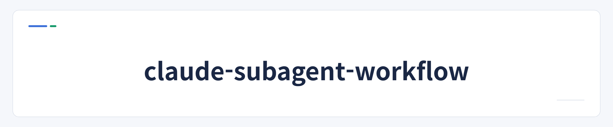

<p align="center">
  
</p>

<p align="center">
  <a href="https://github.com/jbeat30/claude-subagent-workflow/actions/workflows/ci.yml"></a>
  
  
  
  <a href="LICENSE"></a>
</p>

<p align="center"><a href="README.md">한국어</a></p>
# claude-subagent-workflow

**A plugin that installs, with one skill, a Claude Code workflow in which the main session acts as the PM, hands work to role subagents, and an independent QA verifies it**

## What problem does it solve

It is for Claude Code users who worry about these things on larger changes:

- Unstated requirements (validation, error handling) get dropped
- Hidden callers are missed, such as function references or names in config files
- Files outside the assignment get edited
- Unchecked work is reported as done

When you call the workflow, a request goes through intake, plan, confirm, build, and independent QA. Every role reads the original request and the plan file itself, no source is edited before confirmation, only assigned files are edited, and anything not verified stays marked `unchecked`. Your project's existing rules (`CLAUDE.md`, `AGENTS.md`, lint config, and so on) always win. Installing does not change normal Claude conversations; the workflow runs only when you call it with `/subagent`.

## When to use it and when to ask directly

| Call the workflow | Just ask directly |
| --- | --- |
| Changing a function's return shape or an API contract with many callers to fix | Code explanations, questions |
| Adding a feature where unstated requirements are easy to miss | Typos, comments, wording fixes |
| Changes to data structures, permissions, or security where impact must be traced first | Small edits to a single file |

For small tasks, asking directly is faster and cheaper. See [Extra cost and verification level](#extra-cost-and-verification-level) below first.

## Quick start

Requirements: Claude Code 2.1.302 or later, Node 20 or later

```text
/plugin marketplace add jbeat30/jbeat-plugins
/plugin install subagent-workflow@jbeat-plugins
/subagent-workflow:setup
```


The setup skill inspects the project, asks only what it must, shows the change plan, and asks for confirmation once. It does not overwrite existing files and does not touch global settings or feature code. After install, call it like this:

```text
/subagent Add a show/hide password toggle to the existing login screen. Follow the current UI rules.
```

Saying "solve this with the subagent workflow: ..." also works, but the model decides, so it can occasionally miss; use `/subagent` then. Fetching the repository directly is covered in the [install guide](docs/guide/install.en.md).

## Example

A case confirmed in the real evaluation records (one synthetic fixture, one run). It is not proof of effect.

| Step | Content |
| --- | --- |
| User request | Change a function's return type from a number to an object and update everything that uses it |
| Hidden impact | 4 of the 6 callers were hidden in `scripts/`, `tools/`, and sorting code, mixing function references, aliases, and names in config files called dynamically |
| Direct handling | 1 caller broke (cost $0.058) |
| Workflow (Lite, pre-fix instructions) | 0 broken callers (cost $0.61) |

When the same task was rerun 4 times in Lite after the instructions were changed, 1 run broke a caller, 1 run stopped, and 2 runs had 0 broken. Results split, so the case above cannot be generalized. Raw record: [v0.2.0 evaluation results](docs/verification/EVAL_RESULTS_v0.2.0.md) (Korean)

## Extra cost and verification level

- **Cost**: in the case above the cost was about 10 times higher ($0.058 to $0.61). In a 14-run check on small fixtures, Lite cost about 12 times more and took over 30 times longer than direct handling on L2 and L3. After install, the guard check makes one Claude call, and registering MCP servers adds their tool definitions to every call, which raises tokens. Q and L1 requests call no roles.
- **Verification level**: the static checks and unit tests in `npm test` pass, but they do not prove permission blocking, delegation accuracy, or prompt quality. The evaluation used small synthetic fixtures, one run each, one model, non-interactive runs, and there is no guarantee that the workflow improves quality over direct handling.
- **Scope of the bypass block**: during a `/subagent` run the guard blocks the PM from editing directly. Before classification and for questions (Q) no edits are allowed, L1 allows one file, and for L2 and L3 only subagents edit. Classification itself is still the PM's judgment and whether the impact analysis is thorough rests on instructions. Whether this block works has not been measured by repeated evaluation yet. In the evaluation there was a run that classified a request as L3 and still edited directly without this procedure.
- **Experimental**: Full mode, relay execution, and strict mode are not well verified in a real Claude environment.
- **Limits of protection**: the guard hook is a safety net against mistakes, not a security boundary. It cannot stop shell commands in the main session or changes to user and hook settings. Strict mode applies to edits in ordinary conversations where `/subagent` was not called.
- **Not checked**: interactive screens such as the skill permission prompt, macOS and Linux, and updating between releases.

Details: [Safeguards and feature maturity](docs/guide/safety-and-maturity.en.md)

## Guides

| Document | Content |
| --- | --- |
| [Install and choices](docs/guide/install.en.md) | The three skills, what you choose at setup (Context7, document reading, design tool MCP, protection mode, conflict handling), installed files |
| [Using it after install](docs/guide/usage.en.md) | Calling `/subagent`, usage examples, when to call it |
| [How it works](docs/guide/how-it-works.en.md) | Lite and Full structure, roles, task grade flow, project rule priority, against hallucination and unrequested edits, token efficiency |
| [Changing settings](docs/guide/settings.en.md) | Default mode, protection mode, adding and removing MCP servers |
| [Getting a new version, update and removal](docs/guide/update-remove.en.md) | Plugin update, project file update, removal |
| [Safeguards, feature maturity, roadmap](docs/guide/safety-and-maturity.en.md) | Guard hook and protection mode, feature maturity, evaluation records, roadmap |
| [Prompt design principles](docs/PROMPT_DESIGN.en.md) | Rules kept by prompt alone versus rules enforced by hooks and the check runner |
| [Verification records](docs/verification/TESTING.md) (Korean) | Check methods and per-version results |

## Contributing

Issues and fork PRs are welcome. Only the owner has write access, and every change is merged after the owner reviews and approves it.

- Bug reports and feature ideas: [Issues](https://github.com/jbeat30/claude-subagent-workflow/issues/new/choose)
- Proposing changes: fork, then open a PR against the `feature/vX.Y.Z` branch the owner names.
- `main`, `release`, and `feature` require PRs and forbid force pushes; outside contributors cannot push or merge directly.
- Fork PR workflows from outside contributors need the owner's approval to run, regardless of contribution history.
- Development needs Node 20 or later; `npm test` runs static checks and unit tests. See [Testing](docs/verification/TESTING.md) (Korean) for the full method up to real Claude measurement.
- Details: [Contributing](.github/CONTRIBUTING.md), [Branch strategy](.github/BRANCH_STRATEGY.md), [Development rules](AGENTS.md)
- Report security vulnerabilities privately, see [SECURITY.md](SECURITY.md).

## License

[MIT](LICENSE) · Copyright (c) 2026 jbeat
