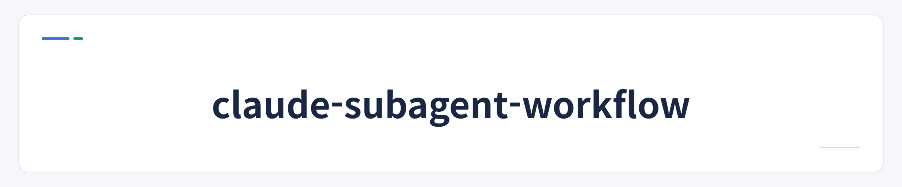

<p align="center">
  
</p>

<p align="center">
  <a href="https://github.com/jbeat30/claude-subagent-workflow/actions/workflows/ci.yml"></a>
  
  
  
  <a href="LICENSE"></a>
</p>

<p align="center"><a href="README.md">한국어</a></p>

# claude-subagent-workflow

**A plugin that makes Claude Code work like a PM.** It plans first, asks when something is unclear, hands the work to role subagents, and has an independent QA verify it before reporting.

## What it does

- **Asks before it builds.** A vague request such as "add a discount" gets options and a recommendation for you to confirm. Only an option whose result actually shows up can be recommended.
- **Finds the impact first.** An analysis role finds the hidden callers, and only the files in the plan are edited.
- **Splits the work by role.** Planning, screen, server, API, and test roles each do only their part. You can add roles for your own domain.
- **Verifies with an independent QA.** Anything not checked is reported as not checked.
- **Follows your project rules.** `CLAUDE.md`, `AGENTS.md`, and lint config always come first; conflicts are asked.

Normal conversations stay the same. The workflow runs only when you call it.

## Install

```text
/plugin marketplace add jbeat30/jbeat-plugins
/plugin install subagent-workflow@jbeat-plugins
/subagent-workflow:setup
```

`setup` surveys the project, asks only what it needs, and writes one project file (`.claude/subagent/profile.md`). The roles and instructions live in the plugin and are not copied into your project.

Requirements: Claude Code 2.1.302 or later, Node 20 or later. Without Node, the workflow says at start that the guard hooks and check records are off and asks whether to continue. On Windows without Git Bash, it runs the same commands with PowerShell.

When the plugin is enabled, it connects to two external services as remote MCP servers. They work without a key, and only library names, general questions, and public URLs are sent. You can turn them off in `/mcp`.

| Server | Purpose |
| --- | --- |
| Context7 | Official library and framework docs for the installed version |
| Jina (web reader) | Read web pages and PDF URLs as Markdown |

Without a key the rate limits are low. If you use Context7 heavily, register the Context7 server with your own key at user scope under the name `context7`, and it is used first. Jina always uses the plugin connection without a key.

## Use

```text
/subagent-workflow:run Add a show-password toggle to the login screen
```

You can also say "solve this with the subagent workflow: ...".

Need a role for your domain? It recommends roles and adds the one you pick.

```text
/subagent-workflow:add-role I build a game engine in C; recommend a subagent for it
```

| Command | What it does |
| --- | --- |
| `/subagent-workflow:run` | Hand over a task |
| `/subagent-workflow:setup` | Set up, update, or remove the project setup |
| `/subagent-workflow:setting` | View, add, or remove optional MCP servers |
| `/subagent-workflow:add-role` | Add or remove a project role |
| `/subagent-workflow:check` | Check the setup (no Claude call) |

## When to use it

| Call the workflow | Just ask |
| --- | --- |
| Changing a return shape or API contract so several callers must change | Explaining code, questions |
| Adding a feature where unstated requirements (validation, errors) are easy to miss | Typos, comments, wording |
| Data structure, permission, or security changes whose impact needs working out first | A small edit to one file |

A simple request still gets handled directly by the PM without subagents, but classifying it has a cost.

## Cost and limits

- Larger tasks call the planning, development, and verification roles several times, so they cost several times more and take longer than handling the task directly.
- The guard hook is a safety net against mistakes, not a security boundary. It cannot stop shell commands in the main session.
- How a task is classified and whether the impact analysis is thorough rest on the instructions. Better quality is not guaranteed.
- Full mode, relay execution, and strict mode from v0.6.x were removed in v0.7.0.

Details: [Safeguards and feature maturity](docs/guide/safety-and-maturity.en.md)

## Docs

| Doc | Content |
| --- | --- |
| [Install and choices](docs/guide/install.en.md) | What you choose at setup, files created in your project |
| [Usage](docs/guide/usage.en.md) | How to call it, examples |
| [How it works](docs/guide/how-it-works.en.md) | Roles, task flow, rule priority, token efficiency |
| [Settings](docs/guide/settings.en.md) | Optional MCP servers |
| [Update and remove](docs/guide/update-remove.en.md) | New versions, moving from older versions, removal |
| [Development tools guide](docs/DEV_TOOLS.en.md) | Owner-only tooling setup for developing this repository |
| [Prompt design principles](docs/PROMPT_DESIGN.en.md) | Rules kept by prompts versus enforced by hooks and scripts |

## Contributing

Issues and fork PRs are welcome. Run `npm test` (Node 20 or later) for static checks and unit tests. See [Contributing](.github/CONTRIBUTING.md) for the rules (Korean). Report security issues privately as described in [SECURITY.md](SECURITY.md).

## License

[MIT](LICENSE), Copyright (c) 2026 jbeat
