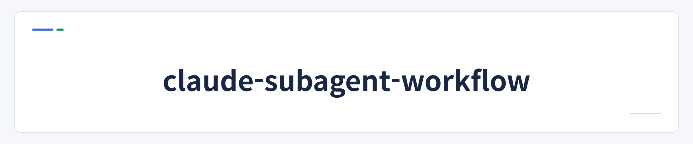

<p align="center">
  
</p>

<p align="center">
  <a href="https://github.com/jbeat30/claude-subagent-workflow/actions/workflows/ci.yml"></a>
  
  
  
  <a href="LICENSE"></a>
</p>

<p align="center"><a href="README.en.md">English</a></p>

# claude-subagent-workflow

**Claude Code가 PM처럼 일하게 하는 플러그인.** 요청을 받으면 먼저 기획하고, 헷갈리는 것은 묻고, 역할별 서브에이전트에게 나눠 맡긴 뒤, 독립 QA가 검증해서 보고해요.

## 무엇을 해 주나요

- **먼저 묻고 시작해요.** "할인 넣어줘"처럼 모호한 요청은 선택지와 추천안을 보여 주고 확인받아요. 추천안은 실제로 결과가 보이는 안만 골라요.
- **영향 범위를 먼저 찾아요.** 영향 분석 역할이 숨은 호출처까지 찾고, 수정은 계획에 적힌 파일만 해요.
- **역할별로 나눠 맡겨요.** 기획, 화면, 서버, API, 테스트 역할이 맡은 일만 해요. 프로젝트에 맞는 역할은 직접 추가할 수 있어요.
- **독립 QA가 검증해요.** 확인하지 못한 것은 확인하지 못했다고 보고해요.
- **프로젝트 규칙을 따라요.** `CLAUDE.md`, `AGENTS.md`, 린터 설정 같은 규칙이 항상 우선이고, 부딪히면 물어요.

평소 대화는 그대로예요. 명령으로 부를 때만 동작해요.

## 설치

```text
/plugin marketplace add jbeat30/jbeat-plugins
/plugin install subagent-workflow@jbeat-plugins
/subagent-workflow:setup
```

`setup`이 프로젝트를 살펴보고 꼭 필요한 것만 물은 뒤, 프로젝트 설정 파일 하나(`.claude/subagent/profile.md`)를 만들어요. 역할과 지침은 플러그인에 들어 있어서 프로젝트에 복사되지 않아요.

요구 사항: Claude Code 2.1.302 이상, Node 20 이상. Node가 없으면 워크플로를 시작할 때 보호 hook과 검사 기록이 꺼져 있다고 알리고, 계속할지 물어요. Git Bash가 없는 Windows에서는 PowerShell로 같은 명령을 실행해요.

플러그인을 켜면 두 외부 서비스에 원격 MCP로 연결돼요. 키 없이 쓰고, 보내는 내용은 라이브러리 이름, 일반 질문, 공개 URL뿐이에요. 원하지 않으면 `/mcp`에서 끌 수 있어요.

| 서버 | 용도 |
| --- | --- |
| Context7 | 설치된 버전에 맞는 라이브러리, 프레임워크 공식 문서 확인 |
| Jina(웹 문서 읽기) | 웹 페이지와 PDF URL을 Markdown으로 읽기 |

키 없이 쓰면 한도가 낮아요. Context7을 많이 쓴다면 자기 키로 Context7 서버를 사용자 범위에 `context7` 이름으로 따로 등록하면 그쪽을 먼저 써요. Jina는 키 없이 플러그인 연결만 써요.

## 사용

```text
/subagent-workflow:run 로그인 화면에 비밀번호 보기 버튼을 추가해줘
```

"서브에이전트 워크플로로 해줘: ..."처럼 말로 불러도 돼요.

프로젝트에 맞는 역할이 필요하면 추가할 수 있어요. 추천을 보여 주고, 고르면 추가해요.

```text
/subagent-workflow:add-role C로 게임 엔진을 개발하는데 맡길 서브에이전트를 추천해줘
```

| 명령 | 하는 일 |
| --- | --- |
| `/subagent-workflow:run` | 작업 맡기기 |
| `/subagent-workflow:setup` | 프로젝트 설정, 갱신, 제거 |
| `/subagent-workflow:setting` | 선택 MCP 보기, 추가, 해제 |
| `/subagent-workflow:add-role` | 프로젝트 역할 추가, 제거 |
| `/subagent-workflow:check` | 설정 상태 점검(Claude 호출 없음) |

## 언제 쓰면 좋나요

| 워크플로를 부르세요 | 그냥 요청하세요 |
| --- | --- |
| 함수 반환 형식이나 API 계약을 바꿔 호출처를 여러 곳 고쳐야 할 때 | 코드 설명, 질문 |
| 말하지 않은 요구(검증, 오류 처리)를 빠뜨리기 쉬운 기능 추가 | 오탈자, 주석, 문구 수정 |
| 데이터 구조, 권한, 보안처럼 영향 범위를 먼저 따져야 하는 변경 | 파일 하나를 고치는 작은 수정 |

간단한 요청을 불러도 PM이 직접 처리해서 서브에이전트를 부르지 않지만, 분류하는 비용은 들어요.

## 비용과 한계

- 큰 작업은 기획, 개발, 검증 역할을 여러 번 부르기 때문에 직접 처리보다 비용과 시간이 여러 배 들어요.
- 가드 hook은 실수를 막는 안전망이지 보안 경계가 아니에요. 메인 세션의 셸 명령은 막지 못해요.
- 작업을 어떤 등급으로 분류할지와 영향 분석이 충분한지는 지침에 기대요. 품질이 항상 높아진다는 보장은 없어요.
- v0.6.x의 Full 모드, relay 실행, 엄격 모드는 v0.7.0에서 없앴어요.

자세한 내용: [안전장치와 기능 성숙도](docs/guide/safety-and-maturity.md)

## 문서

| 문서 | 내용 |
| --- | --- |
| [설치와 선택 항목](docs/guide/install.md) | 설정할 때 고르는 항목, 프로젝트에 생기는 파일 |
| [사용법](docs/guide/usage.md) | 부르는 방법, 사용 예 |
| [동작 방식](docs/guide/how-it-works.md) | 역할 구성, 작업 흐름, 규칙 우선순위, 토큰 효율 |
| [설정 바꾸기](docs/guide/settings.md) | 선택 MCP |
| [갱신과 제거](docs/guide/update-remove.md) | 새 버전 받기, 이전 버전에서 옮기기, 제거 |
| [프롬프트 설계 원칙](docs/PROMPT_DESIGN.md) | 프롬프트로 지키는 규칙과 hook, 스크립트로 강제하는 규칙 |
| [개발 도구 가이드](docs/DEV_TOOLS.md) | 이 저장소를 개발하는 소유자용 도구 설정(컨벤션, Ponytail, Graphify, Headroom) |

## 기여

이슈와 포크 PR을 환영해요. `npm test`(Node 20 이상)로 정적 검사와 단위 테스트를 돌려요. 자세한 규칙은 [기여 안내](.github/CONTRIBUTING.md)에 있어요. 보안 취약점은 [SECURITY.md](SECURITY.md)를 보고 비공개로 제보해 주세요.

## 라이선스

[MIT](LICENSE), Copyright (c) 2026 jbeat
