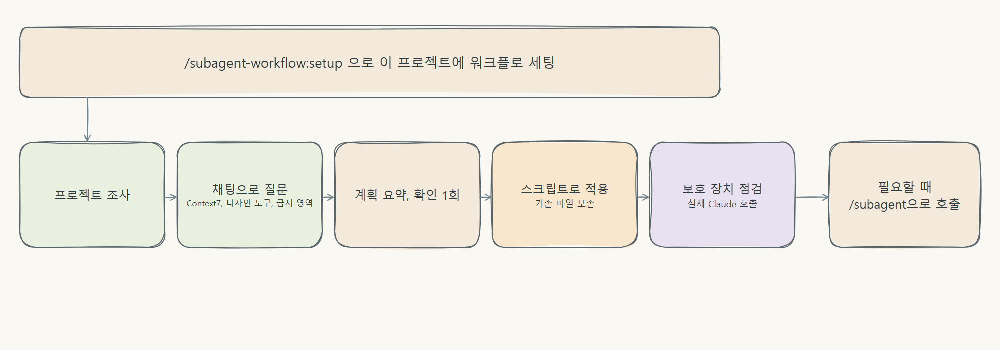

<p align="center">
  
</p>

<p align="center">
  <a href="https://github.com/jbeat30/claude-subagent-workflow/actions/workflows/ci.yml"></a>
  
  
  
  <a href="LICENSE"></a>
</p>

<p align="center"><a href="README.en.md">English</a></p>
# claude-subagent-workflow

**메인 세션이 PM이 되어 역할별 서브에이전트에 일을 나누고, 독립 QA가 검증하게 하는 Claude Code 워크플로를 스킬 한 번으로 설치하는 플러그인**

## 어떤 문제를 푸나요

대상은 큰 변경에서 이런 일이 걱정되는 Claude Code 사용자예요.

- 말하지 않은 요구(검증, 오류 처리 등)를 빠뜨림
- 함수 참조나 설정 파일 속 이름처럼 숨은 호출처를 놓침
- 맡지 않은 파일까지 고침
- 확인하지 않은 것을 "완료"로 보고

워크플로를 부르면 요청이 접수 → 기획 → 확인 → 개발 → 독립 QA 순서로 진행돼요. 모든 역할이 요청 원문과 기획안을 직접 읽고, 확인 전에는 소스를 고치지 않고, 배정된 파일만 수정하고, 확인하지 못한 항목은 `unchecked`로 남겨요. 프로젝트의 기존 규칙(`CLAUDE.md`, `AGENTS.md`, 린터 설정 등)이 항상 우선이에요. 설치해도 평소 Claude 대화는 그대로이고, `/subagent`으로 부를 때만 일해요.

## 언제 쓰고, 언제 직접 처리할까요

| 워크플로를 불러 보세요 | 그냥 요청하세요 |
| --- | --- |
| 함수 반환 형식이나 API 계약을 바꿔서 호출처를 여러 곳 고쳐야 할 때 | 코드 설명, 질문 |
| 말하지 않은 요구를 빠뜨리기 쉬운 기능 추가 | 오탈자, 주석, 문구 수정 |
| 데이터 구조, 권한, 보안처럼 영향 범위를 먼저 따져야 하는 변경 | 파일 하나를 고치는 작은 수정 |

작은 작업은 직접 요청하는 편이 빠르고 저렴해요. 비용은 아래 [추가 비용과 검증 수준](#추가-비용과-검증-수준)을 먼저 보세요.

## 빠른 시작

요구 사항: Claude Code 2.1.302 이상, Node 20 이상

```text
/plugin marketplace add jbeat30/jbeat-plugins
/plugin install subagent-workflow@jbeat-plugins
/subagent-workflow:setup
```



설치 스킬이 프로젝트를 조사하고 꼭 필요한 것만 묻고, 변경 계획을 보여 준 뒤 확인은 한 번만 받아요. 기존 파일은 덮어쓰지 않고 전역 설정과 기능 코드는 건드리지 않아요. 설치 후에는 이렇게 불러요.

```text
/subagent 기존 로그인 화면에 비밀번호 표시 전환을 추가해줘. 현재 UI 규칙을 따라줘.
```

"서브에이전트 워크플로로 해결해 줘: ..."처럼 말로 불러도 되지만 모델이 판단하는 방식이라 가끔 놓칠 수 있어요. 그때는 `/subagent`을 쓰세요. 저장소를 직접 가져오는 방식은 [설치 가이드](docs/guide/install.md)에 있어요.

## 사례

실제 평가 기록(합성 fixture 한 개, 반복 1회)에서 확인된 사례예요. 효과를 입증하는 결과는 아니에요.

| 단계 | 내용 |
| --- | --- |
| 사용자 요청 | 함수 반환 타입을 숫자에서 객체로 바꾸고, 이 함수를 쓰는 곳을 모두 맞춰 달라는 요청 |
| 숨은 영향 | 호출처 6곳 중 4곳이 `scripts/`, `tools/`, 정렬 코드 등에 숨어 있었고 함수 참조 전달, 별칭, 설정 파일의 이름 문자열 호출이 섞여 있었음 |
| 직접 처리 | 호출처 1곳이 깨짐(비용 0.058달러) |
| 워크플로(Lite, 개선 전 지침) | 깨진 호출처 0(비용 0.61달러) |

같은 과제를 지침을 고친 뒤 Lite로 4회 다시 돌렸을 때는 1회가 호출처 1곳 파손, 1회가 중단이었고 2회가 파손 0이었어요. 결과가 갈리므로 위 사례를 일반화할 수 없어요. 원본 기록: [v0.2.0 평가 결과](docs/verification/EVAL_RESULTS_v0.2.0.md)

## 추가 비용과 검증 수준

- **비용**: 위 사례에서 비용이 약 10배(0.058 → 0.61달러)였어요. 소규모 fixture 14회 확인에서 Lite는 직접 처리보다 L2·L3에서 비용이 약 12배, 시간이 30배 이상 들었어요. 설치 직후 보호 장치 점검에서 Claude를 1회 호출하고, MCP를 등록하면 도구 정의가 호출마다 붙어 토큰이 늘어요. Q와 L1 요청에서는 역할을 호출하지 않아요.
- **검증 수준**: `npm test`의 정적 검사와 단위 테스트는 통과하지만 권한 차단, 위임 정확도, 프롬프트 품질을 입증하지는 않아요. 평가는 작은 합성 fixture, 반복 1회, 한 모델, 비대화형 실행이고 워크플로가 직접 처리보다 품질을 높인다는 보장은 없어요.
- **강제되지 않는 규칙**: L3 절차(기획서, 영향 분석, 사용자 확인)를 지키는지는 지침에만 기대고 있어요. 평가에서 L3로 분류하고도 이 절차 없이 직접 수정한 사례가 있었어요.
- **실험적 기능**: Full 모드, relay 실행, 엄격 모드는 실제 Claude 환경에서 충분히 검증하지 못했어요.
- **보호 장치의 한계**: 가드 hook은 실수를 막는 안전망이고 보안 경계가 아니에요. 메인 세션의 셸 명령과 사용자·hook 설정 변경은 막지 못해요. 엄격 모드는 `/subagent`을 부르지 않은 평소 대화의 수정에도 적용돼요.
- **미확인**: 스킬 실행 허용 창 같은 대화형 화면, macOS·Linux, 릴리즈 사이의 갱신은 확인하지 못했어요.

자세한 내용: [안전장치와 기능 성숙도](docs/guide/safety-and-maturity.md)

## 가이드

| 문서 | 내용 |
| --- | --- |
| [설치와 선택 항목](docs/guide/install.md) | 스킬 3종, 설치할 때 고르는 항목(Context7, 문서 읽기, 디자인 도구 MCP, 보호 모드, 충돌 처리), 설치되는 파일 |
| [설치 후 사용](docs/guide/usage.md) | `/subagent` 호출, 사용 예, 언제 부르면 좋은지 |
| [동작 방식](docs/guide/how-it-works.md) | Lite·Full 구성, 역할, 작업 등급 흐름, 프로젝트 규칙 우선순위, 환각·임의 수정 방지, 토큰 효율 |
| [설정 바꾸기](docs/guide/settings.md) | 기본 모드, 보호 모드, MCP 추가·해제 |
| [새 버전 받기와 갱신·제거](docs/guide/update-remove.md) | 플러그인 갱신, 프로젝트 파일 갱신, 제거 |
| [안전장치, 기능 성숙도, 로드맵](docs/guide/safety-and-maturity.md) | 가드 hook과 보호 모드, 기능 성숙도, 평가 기록 목록, 로드맵 |
| [프롬프트 설계 원칙](docs/PROMPT_DESIGN.md) | 프롬프트로만 지켜지는 규칙과 hook·검사 실행기로 강제되는 규칙 |
| [검증 기록](docs/verification/TESTING.md) | 검사 방법과 버전별 점검 결과 |

## 기여

이슈와 포크 PR을 환영해요. 저장소 쓰기 권한은 소유자만 갖고 있고, 모든 변경은 소유자가 검토·승인한 뒤에 머지돼요.

- 문제 제보·기능 제안: [Issues](https://github.com/jbeat30/claude-subagent-workflow/issues/new/choose)
- 변경 제안: 저장소를 포크한 뒤 PR을 보내 주세요. 대상은 소유자가 지정한 `feature/vX.Y.Z`예요.
- `main`·`release`·`feature`는 PR이 필수이고 강제 푸시가 금지돼요. 외부 기여자는 직접 푸시하거나 머지할 수 없어요.
- 외부 기여자의 포크 PR 워크플로는 기여 이력과 관계없이 소유자의 실행 승인이 필요해요.
- 개발 환경은 Node 20 이상이에요. `npm test`로 정적 검사와 단위 테스트를 돌려요. 실제 Claude 측정까지의 검사 방법은 [검사 방법](docs/verification/TESTING.md)을 보세요.
- 자세한 규칙: [기여 안내](.github/CONTRIBUTING.md), [브랜치 전략](.github/BRANCH_STRATEGY.md), [개발 규칙](AGENTS.md)
- 보안 취약점은 [SECURITY.md](SECURITY.md)를 보고 비공개로 제보해 주세요.

## 라이선스

[MIT](LICENSE) · Copyright (c) 2026 jbeat
