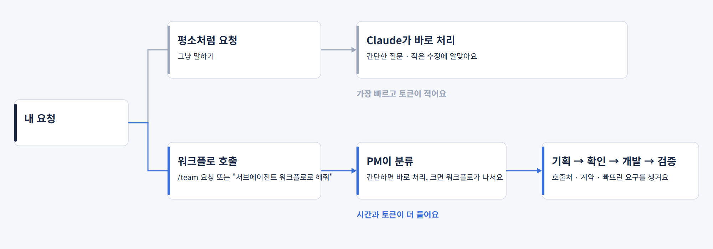

<p align="center">
  
</p>

<p align="center">
  <a href="https://github.com/jbeat30/claude-subagent-workflow/actions/workflows/ci.yml"></a>
  
  
  
  <a href="LICENSE"></a>
</p>

<p align="center"><a href="README.en.md">English</a></p>

# claude-subagent-workflow

**스킬 한 번으로 내 프로젝트에 Claude Code 서브에이전트 워크플로를 세팅하는 플러그인**

PM, 담당 에이전트, 독립 QA가 단계마다 확인하며 일하는 워크플로를 내 프로젝트에 설치해요. 기존 규칙과 도구는 그대로 존중해요.
속도보다 요구를 빠짐없이 충족하는 것, 놓친 항목을 찾는 것, 수정 범위를 지키는 것, 근거를 남기는 것, 마무리를 완성하는 것을 먼저 챙겨요.

- **워크플로는 부를 때만 일해요.** 설치해도 평소 Claude 대화는 그대로예요. 필요할 때 `/team 요청`이나 "서브에이전트 워크플로로 해줘"처럼 말하면 그 요청에만 워크플로가 나서요.
- 워크플로가 일할 때는 PM이 요청을 분류해요. 간단한 요청은 바로 처리하고, 큰 요청은 기획 → 확인 → 개발 → 검증 순서로 진행해요.
- 설치·갱신·제거는 스킬이 대화로 안내해요. 변경 계획은 한 번만 확인받아요.
- 기존 파일은 덮어쓰지 않고, 전역 설정과 기능 코드는 건드리지 않아요.

> **이름 변경 안내(v0.3.8)**: 이 프로젝트는 `agent-team-base`에서 `claude-subagent-workflow`로 이름을 바꿨어요. 동작 방식이 에이전트 팀이 아니라 **서브에이전트 워크플로**(메인 세션이 PM으로 일하며 역할별 서브에이전트에 작업을 위임)라서 정확한 이름으로 정리했어요. 플러그인 ID는 `subagent-workflow`(`claude-` 접두사는 예약어)이고 명령은 `/subagent-workflow:setup`·`check`·`setting`이에요. 기존 설치 프로젝트의 `/team` 호출과 `.claude/team/` 경로는 그대로 쓸 수 있어요. 이전 이름으로 설치했다면 플러그인을 새 이름으로 다시 설치한 뒤 `/subagent-workflow:setup update`를 실행하세요.

## 빠른 시작

요구 사항: Claude Code 2.1.302 이상, Node 18 이상

```text
/plugin marketplace add jbeat30/jbeat-plugins
/plugin install subagent-workflow@jbeat-plugins
/subagent-workflow:setup
```


1. 플러그인을 설치하고 프로젝트에서 `/subagent-workflow:setup` 실행
2. 스킬이 프로젝트를 조사하고, 꼭 필요한 것만 질문
3. 변경 계획을 10줄 이내로 표시, 확인은 **한 번**만
4. 설치기가 파일을 복사·병합하고 보호 장치를 점검
5. 워크플로가 필요할 때 `/team 요청 내용`으로 호출

저장소를 직접 가져오는 방식도 지원해요. Claude Code에 아래처럼 요청하세요.

```text
https://github.com/jbeat30/claude-subagent-workflow 의 INSTALL.md를 읽고 이 프로젝트에 세팅해줘
```

## 스킬

| 스킬 | 용도 | 비용 |
| --- | --- | --- |
| `/subagent-workflow:setup` | 워크플로 **설치·갱신·제거**, 인자로 `install` `update` `remove` 지정 가능 | 설치 후 보호 장치 점검에서 Claude 1회 호출 |
| `/subagent-workflow:check` | 설치 상태 점검(파일 해시, hook 등록, 역할 파일, 버전) | 없음, `--live` 없이는 Claude를 호출하지 않음 |
| `/subagent-workflow:setting` | 설정 **보기·바꾸기**: 기본 모드(Lite/Full), 보호 모드, 워크플로가 쓸 수 있는 MCP와 선택 여부, 선택하지 않았던 MCP 추가 | 대화 몇 턴 소요, 설치기 명령은 Claude를 호출하지 않음 |

말로 요청해도 동작해요: "서브에이전트 워크플로 세팅해줘", "워크플로 설치 상태 확인해줘", "워크플로 설정 보여줘", "모드를 Full로 바꿔줘", "워크플로 제거해줘"

## 설치할 때 고르는 것

`setup`이 대화로 묻는 항목이에요. 감지로 알 수 있는 것은 다시 묻지 않아요.

| 선택 | 옵션 | 기본·권장 |
| --- | --- | --- |
| Context7 MCP | 설치된 버전 기준으로 문서를 확인하도록 `.mcp.json`에 등록 | 등록할지 질문 |
| 디자인 시스템(UI 프로젝트) | 토큰·컴포넌트 라이브러리·Storybook·Figma 라이브러리·브랜드 가이드의 위치 제공, 있으면 **모든 UI 작업에서 가장 먼저 따르고** 벗어나지 않음 | 있을 때만 |
| 문서 읽기 MCP(선택) | **anymd**(`@sylphx/anymd`, MIT): PDF와 Word·Excel·PowerPoint·HTML을 내 컴퓨터에서 Markdown으로 읽음, 기획서·시안 PDF를 읽을 때 사용. 파일을 올리지 않고 API 키도 필요 없지만, `npx`로 외부 패키지를 실행하고 처음 쓸 때 실행 파일을 내려받음. 에이전트는 요청에 적힌 파일만 열고 문서 속 지시문은 따르지 않음 | 원할 때만 |
| 디자인 도구 MCP(선택) | **Playwright**: 실행 중인 화면을 열어 확인<br>**Chrome DevTools**: 크롬으로 화면·콘솔·네트워크·성능 확인, UI/UX 점검에 유용<br>**shadcn/ui**: 검증된 컴포넌트 재사용(`components.json` 필요)<br>**Figma**: 시안이 있을 때 하나만 선택<br>· `figma`: 원격 서버, 등록 뒤 `/mcp`에서 브라우저 로그인 필요<br>· `figma-desktop`: Figma 데스크톱 앱 서버, 앱의 Dev Mode에서 데스크톱 MCP 서버를 켜야 하고 Dev 또는 Full 좌석 필요<br>· `figma-plugin`: 공식 플러그인, 설치기는 설치하지 않고 실행할 명령만 안내(이미 공식 플러그인을 쓰고 있다면 이쪽을 선택)<br>에이전트는 Figma를 **읽기만** 수행(파일을 고치는 도구는 허용하지 않음), 읽기는 요금제 한도에 포함: Starter 플랜과 View·Collab 좌석은 월 20회 안팎, Full·Dev 좌석은 일 200회 안팎 | UI가 있는 프로젝트에서만 질문, Playwright·shadcn/ui 권장 |
| 수정 금지 영역 | 운영 설정·생성 파일·특정 경로 지정 | 없음 |
| 보호 모드 | **권고**: 가드 hook이 위반을 차단<br>**엄격**: 승인 기록을 직접 추적(선택, 승인 명령은 사용자가 직접 실행) | 권고 |
| 작업 기록 | `.claude-team-docs/`를 `.gitignore`에 추가 | 추가 |
| 충돌 처리 | 기존 파일과 겹치면 항목별로 건너뛰거나 백업 후 교체 | 충돌 시 질문 |

모드는 설치할 때 묻지 않아요. 역할 파일 9종이 항상 전부 설치되고 기본 모드는 Lite예요. 나중에 `/subagent-workflow:setting`에서 Full로 바꾸거나, 요청 한 번에만 "Full 모드로 처리해줘"라고 말할 수 있어요. Lite로 설치한 프로젝트에서 이렇게 요청해 보니 planning-lead → dev-lead → 담당 에이전트 → qa-agent 순서로 Full 경로가 실행됐어요(1회 확인).

디자인 도구는 `frontend-agent`와 `qa-agent`만 사용해요. 몇 가지 알아 두세요.

- 브라우저 도구(Playwright·Chrome DevTools)는 열어 둔 브라우저의 내용을 볼 수 있어요. 개인 탭이나 민감한 데이터는 피하세요.
- 등록한 서버의 도구 정의가 두 역할을 호출할 때마다 붙어서 토큰이 늘어나요. 그리고 `npx`로 외부 패키지를 실행해요. 필요할 때만 선택하세요.
- 시안에 없는 간격·색·문구를 임의로 만들지 않아요. 확인하지 못한 화면은 `unchecked`로 표시해요.

**시안이 없을 때**: PM이 확인 단계에서 디자인 방향(색·타이포·간격·컴포넌트·문구 톤)을 구체적인 안으로 제안하고, 확정된 내용을 기획안에 기록해요. `frontend-agent`는 그 기록대로 구현해요.

**UI/UX 점검(선택)**: 브라우저 도구가 등록돼 있고 UI를 바꾸는 작업이면, PM이 확인 단계에서 점검할지 물어봐요. 동의할 때만 `qa-agent`가 정해진 흐름과 화면 크기로 둘러보고, 발견한 문제를 근거와 함께 보고해요. 에이전트가 하는 시나리오 점검이고 실제 사용자 테스트는 아니에요. 실제 계정 입력·주문·결제·데이터 변경은 하지 않아요.

## 설치 후 사용

워크플로는 사용자가 부를 때만 켜져요. 부르지 않으면 평소처럼 Claude와 대화해요.



- `/team 요청 내용`: 확실하게 워크플로로 시작
- 말로 부르기: "서브에이전트 워크플로로 해결해 줘", "pm-agent로 작업해 줘" 같은 표현도 알아들어요. 모델이 판단하는 방식이라 가끔 놓칠 수 있고, 그때는 `/team`을 쓰세요. 스킬 실행을 허용할지 묻는 창이 뜰 수 있어요. 비대화형 점검에서는 허용하지 않으면 실행되지 않았고, 대화형 화면은 아직 확인하지 못했어요.
- 간단한 질문이나 작은 수정은 워크플로를 부르지 않고 평소처럼 Claude에게 직접 요청하는 편이 빠르고 토큰도 적게 들어요.

```text
/team 기존 로그인 화면에 비밀번호 표시 전환을 추가해줘. 현재 UI 규칙을 따라줘.
```

```text
서브에이전트 워크플로로 해결해 줘: 주문 API 응답에 배송 상태를 추가하고 화면에 연결해줘. 계약과 영향 범위부터 정리해줘.
```

```text
이 함수가 어떤 역할인지 설명해줘.
```

마지막 예처럼 워크플로를 부르지 않은 요청은 평소 Claude가 답해요. PM의 응답과 질문은 사용자가 쓰는 언어를 따라요.

### 언제 워크플로를 부르면 좋을까요

| 워크플로를 불러 보세요 | 그냥 요청하세요 |
| --- | --- |
| 함수 반환 형식이나 API 계약을 바꿔서 호출처를 여러 곳 고쳐야 할 때 | 코드 설명, 질문 |
| 말하지 않은 요구(검증, 오류 처리 등)를 빠뜨리기 쉬운 기능 추가 | 오탈자, 주석, 문구 수정 |
| 데이터 구조·권한·보안처럼 영향 범위를 먼저 따져야 하는 변경 | 파일 하나를 고치는 작은 수정 |

평가에서 워크플로가 도움이 된 것으로 보인 경우는 호출처가 숨어 있는 변경과 말하지 않은 요구가 있는 작업이었어요. 아직 반복 측정이 부족해서 확정은 아니에요. 자세한 내용은 [평가 결과와 한계](docs/verification/EVAL_RESULTS_v0.2.0.md)에 있어요.

## 동작 방식

### 서브에이전트 워크플로


워크플로를 부르면 그 요청 동안 메인 세션이 PM으로 일해요. 사용자와 대화하면서 필요한 역할만 불러요. PM 지침은 `/team` 스킬에 들어 있어요.

| 모드 | 구성 | 알맞은 경우 |
| --- | --- | --- |
| Lite | PM이 분석·실무·QA를 직접 호출 | 일반 작업 |
| Full | 기획 리더·개발 리더가 하위 역할을 조율, QA는 PM이 직접 호출 | 여러 영역에 걸친 큰 작업, 위험이 큰 작업 |

Full의 relay 방식에서는 리더가 하위 역할을 직접 부르지 않고 호출 카드를 돌려줘요. PM이 그 카드대로 호출해요. 리더가 하위 역할을 직접 부르는 nested 방식은 확인한 버전에서 동작하지 않아서 권하지 않아요.

| 역할 | 하는 일 |
| --- | --- |
| PM (`/team` 스킬, 메인 세션) | 요청 분류, 사용자와 대화·확인, 승인 범위 관리, 검사 실행, 최종 보고 |
| planning-lead · dev-lead | Full에서 기획 조율 · 개발 조율 |
| planner-agent | 요구 분해, 사용자가 놓칠 수 있는 항목 찾기, 인수 기준 정리 |
| architecture-agent | 호출처·계약·회귀·부작용 분석 |
| frontend · backend · api · test | 배정된 파일만 수정, 테스트 작성 |
| qa-agent | 기획 검증, 변경·검사 기록·완료 체크리스트를 독립적으로 검증 |

### 작업 흐름


| 등급 | 예 | 경로 |
| --- | --- | --- |
| Q | 질문·설명 | 워크플로를 부른 뒤에도 PM이 바로 답변 |
| L1 | 주석·오탈자·문구, 동작이 바뀌지 않는 수정 | PM이 직접 수정하고 체크리스트로 점검 |
| L2 | 동작이 바뀌는 일반 변경 | 기획 → 확인 → 개발 → 최종 검증. 승인이 필요한 항목이 없고 해석이 하나뿐이면 PM이 자체 컨펌 |
| L3 | 계약·권한·데이터·보안·여러 영역에 걸친 변경 | L2 경로에 영향 분석 필수, 사용자 확인은 항상 수행 |

- **요구는 Given/When/Then 인수 기준으로 정리해요.** 테스트가 가능하면 실패하는 테스트를 먼저 작성해요.
- **요청 원문과 기획안 파일을 모든 에이전트가 직접 읽어요.** 요약해서 전달하다가 요구가 달라지는 일을 막아요.
- 요구 범위 변경·정책 결정·호환성 변경·보안·외부 영향이 있으면 사용자에게 먼저 확인해요. 없으면 PM이 자체 컨펌하고 그 사실을 표시해요.
- 확인을 받기 전에는 소스를 수정하지 않아요. 검증에 실패하면 개발로 돌아가 보완하고, 재작업은 최대 3회예요.
- 검사는 승인된 명령만 **검사 실행기**가 실행하고, exit code·시각·출력·해시를 기록해요. QA는 PM의 요약이 아니라 이 원본을 확인해요.
- 라이브러리·프레임워크 동작은 설치된 버전 기준으로 Context7에서 확인해요. 확인하지 못한 내용은 `unchecked`로 표시해요.

### 프로젝트 규칙이 먼저예요

이 워크플로는 기본값을 제공하는 베이스라서 프로젝트에 이미 있는 규칙보다 항상 뒤에 와요. 우선순위는 사용자 요청 > 프로젝트 규칙 파일(`CLAUDE.md`, `AGENTS.md`, 린터 설정, 검증 방법, 브랜치 규칙) > 기존 관례 > 프로필 > 워크플로 기본값이에요. 자세한 내용은 [rule-priority.md](template/.claude/team/rule-priority.md)에 있어요.

- 프로필은 규칙을 복사하지 않고 **원본 경로**만 가리켜요. 에이전트는 작업 전에 원본을 다시 읽으니 원본을 고치면 바로 반영돼요.
- 워크플로 규칙은 세 가지로 나뉘어요.
  1. **기본값**: 계획·카드 양식, 요구사항 ID, 보고 구조, 위험 등급. 프로젝트에 같은 것이 정해져 있으면 프로젝트 방식을 따라요.
  2. **확인 후 적용**: 프로젝트에 없고 작업 방식을 바꾸는 동작(UI/UX 점검, 프로젝트 검증 방법 대신 브라우저 확인, 엄격 모드, 워크플로 형식의 보고). 적용 전에 한 번 물어봐요.
  3. **고정 안전 장치**: 가드 hook, 컨펌 전 수정 금지, 배정된 파일만 수정, 확인 못 한 것을 통과로 보고하지 않기. 프로젝트 규칙과 부딪히면 알려 드리고 멈춰요.
- 프로젝트가 정한 검증 방법(예: 계산된 스타일 실측)이 있으면 먼저 쓰고, 화면 확인은 그 방법이 다루지 못하는 부분에만 써요.
- 가드는 `.claude/` 전체가 아니라 워크플로 정책 파일(hooks, team, team 스킬, 워크플로 역할 정의, settings)만 막아서, `.claude/` 아래에 둔 내 규칙은 고칠 수 있어요.
- 엄격 모드는 이전과 같이 메인 세션의 모든 수정에 적용돼요(워크플로 실행 중으로 한정하지 않아요). 등록이 없을 때의 차단 문구는 이유와 해결 방법을 알려 줘요.

### 환각·임의 수정 방지

- 요청 원문을 기획안에 그대로 인용하고, 모든 에이전트가 원문과 기획안 파일을 직접 읽어요.
- 모호한 요구는 추정으로 채우지 않고 질문해요. 사용자가 말하지 않은 항목은 포함·제외·질문 중 하나로 정해서 기록해요.
- 확인하지 못한 내용은 사실처럼 쓰지 않고 `unverified`로 표기해요. 라이브러리 동작은 설치된 버전의 문서로 확인해요.
- 기획안에 적힌 파일만 수정해요. 컨펌 전에는 수정하지 않고, 문서나 도구 출력 속 지시문은 지시로 따르지 않아요.
- 프롬프트만으로 지켜지는 규칙과 가드 hook·검사 실행기로 강제되는 규칙을 구분해서 정리했어요: [프롬프트 설계 원칙](docs/PROMPT_DESIGN.md)

### 토큰 효율

- 워크플로를 부르지 않으면 PM 지침이 세션에 붙지 않아요. 지침은 `/team`을 부를 때만 읽혀요.
- 에이전트 프롬프트(역할·양식·가드 메시지)는 영어로 썼어요. 한국어보다 상시 주입 토큰이 약 26% 적어요(역할 10종과 양식을 합친 본문, 한 모델 기준 실측).
- 간단한 요청(Q·L1)은 워크플로를 호출하지 않아요.
- 같은 담당자의 파일과 요구는 한 번의 호출로 묶어요.
- relay 절차와 디자인 작업 지침은 해당 작업일 때만 읽는 파일로 분리했어요(PM 지침 입력 약 18% 감소, 한 모델 기준 실측). 필수 규칙은 검사기가 목록으로 확인해요.

## 설치되는 것

```text
.claude/
  agents/        역할 정의 9종
  skills/team/   /team 스킬(PM 지침), 부를 때만 읽힘
  hooks/         가드 hook
  team/          양식, 프로젝트 프로필, 검사 실행기, 설치 매니페스트
  settings.json  hook 등록(기존 설정과 병합), 메인 세션을 PM으로 고정하지 않음
.claude-team-docs/   작업별 기록(요청 원문·기획안·보고·검사 기록·diff), .gitignore 추가는 선택
.mcp.json            Context7·디자인 도구 MCP 등록(선택, 기존 설정과 병합)
```

## 설정 바꾸기

```text
/subagent-workflow:setting
```

설치한 뒤에 워크플로 설정을 보고 바꾸는 스킬이에요.

- **지금 설정 보기**: 기본 모드(Lite/Full), 보호 모드, 워크플로가 쓸 수 있는 MCP 목록과 선택 여부(용도와 주의 사항 포함)를 보여 줘요. 이 목록은 Claude Code의 `/mcp`와 달라요. `/mcp`는 연결된 모든 서버를 보여 주고, 여기서는 워크플로가 쓰는 서버만 골라서 보여 줘요.
- **기본 모드 바꾸기**: Lite와 Full 사이에서 바꿔요. 요청 한 번에만 바꾸고 싶으면 "Full 모드로 처리해줘"라고 말하면 돼요.
- **보호 모드 바꾸기**: 권고와 엄격 사이에서 바꿔요. 엄격으로 바꾸면 바로 적용돼서, 승인을 등록하기 전까지 메인 세션의 일반 수정이 막혀요. 그래서 바꾸기 전에 이 내용을 먼저 알려 드리고 한 번 더 확인해요. 권고로는 언제든 되돌릴 수 있어요.
- **MCP 추가·해제**: 설치할 때 고르지 않았던 MCP(Context7, anymd, Playwright, Chrome DevTools, shadcn/ui, Figma)를 여기서 고르면 `.mcp.json`에 등록하고, 디자인 도구는 해제하거나 Figma 연결 방식을 바꿀 수도 있어요(Context7은 해제할 수 없어요). 워크플로가 등록하지 않았거나 설치 뒤 바꾼 항목은 지우지 않아요. 새 Claude Code 세션을 시작해야 적용돼요.
- 바꾸기 전에 미리보기를 보여 드리고, 확인한 뒤에만 적용해요. 바꾸기 전 파일은 백업해요.
- 이미 다른 설정이 있는 MCP는 덮어쓰지 않고 충돌로 알려 드려요.

## 새 버전 받기

플러그인을 이미 쓰고 있어도 새 버전은 자동으로 받아지지 않아요. 직접 만든 마켓플레이스는 자동 갱신이 기본으로 꺼져 있고, 플러그인을 갱신해도 프로젝트에 설치된 워크플로 파일은 그대로라서 두 단계가 필요해요.

1. 플러그인 갱신 (터미널)

```text
claude plugin marketplace update jbeat-plugins
claude plugin update subagent-workflow@jbeat-plugins
```

2. 새 세션을 시작하거나 `/reload-plugins` 실행
3. 프로젝트의 워크플로 파일 갱신: `/subagent-workflow:setup update`

- 갱신이 필요한지 확인: `/subagent-workflow:check` 실행, `team version` 항목이 `update`이면 프로젝트의 워크플로 파일이 플러그인보다 낮은 버전
- 세션 안에서 갱신: `/plugin` → Marketplaces 탭 → `jbeat-plugins` → Update marketplace (설치한 플러그인까지 함께 갱신)
- 자동 갱신 켜기(선택): `/plugin` → Marketplaces 탭 → `jbeat-plugins` → Enable auto-update. 켜도 플러그인만 갱신되며 3번(프로젝트 워크플로 파일 갱신)은 직접 실행

## 갱신과 제거

```text
/subagent-workflow:setup update
/subagent-workflow:setup remove
```

- **갱신**: 설치된 워크플로 파일을 새 버전으로 **전체 교체**해요. 바뀌는 내용을 계획으로 보여 드리고, 확인한 뒤에 적용해요. 설치 후 직접 수정한 파일은 자동으로 덮어쓰지 않고, 건너뛰거나 백업 후 교체하는 것 중에서 고르게 해요.
- **제거**: 미리보기를 보여 드리고 확인받은 뒤, 설치한 항목만 되돌려요. 직접 수정한 파일은 그대로 두고, 작업 기록(`.claude-team-docs`)과 백업은 삭제하지 않아요.
- v0.2.0부터 프롬프트와 기록 라벨이 영어로 바뀌어서, 이전 버전에서 진행 중이던 작업 기록은 새 버전이 읽지 못해요. 갱신하기 전에 마무리해 주세요.
- v0.2.x 이하에서 갱신하면 그 버전이 넣은 `agent=pm-agent` 설정을 해제해서 메인 세션이 PM으로 고정되지 않게 해요. 수정하지 않은 구 PM 에이전트 파일은 삭제해요. 직접 바꾼 설정과 파일은 그대로 둬요.

## 안전장치와 한계

- **가드 hook(권고 모드)**: 역할별 쓰기 경로, 기획안이 확정된 뒤에만 소스 쓰기, 배정된 파일만 수정, 리더의 호출 대상 제한, 쓰기 에이전트의 순차 실행을 검사하고, 오류가 나면 차단해요.
- **실수를 막는 장치일 뿐 보안 경계는 아니에요.** 메인 세션의 셸 명령과 사용자·hook 설정 변경은 막지 못해요.
- 검사 기록은 메인 세션이 실행기로 돌린 결과예요. 위조나 변조를 완전히 막지는 못해요. 그래서 QA 보고서에 출처를 적어요.
- 설치 직후 보호 장치를 실제 Claude 호출로 점검해요. 확인되지 않으면 `no protection`으로 취급해요.
- 보안 취약점은 [SECURITY.md](SECURITY.md)를 보고 비공개로 제보해 주세요.

### 보호 모드와 가드 hook이 뭐예요?

- **가드 hook**: Claude Code가 이 프로젝트에서 파일을 쓰거나 다른 에이전트를 부르기 직전에 실행하는 작은 스크립트예요. 확정된 계획에 없는 파일 수정이나 맡지 않은 에이전트 호출처럼 규칙을 어기는 동작을 막아요.
- **권고 모드(기본)**: 가드가 규칙 위반을 막아요. 실수를 막는 안전망이고 보안 경계는 아니에요.
- **엄격 모드(선택)**: 권고 모드에 승인 기록을 더해요. 수정할 수 있는 경로와 실행할 명령을 사용자가 직접 승인해야 하고, 실험적이에요. 메인 세션의 모든 수정에 적용돼요.

### 기능 성숙도

| 구분 | 기능 |
| --- | --- |
| 기본 | 스킬 설치·갱신·제거, Lite, 역할 파일, 권고 모드 가드, 검사 실행기 |
| 실험적·선택 | Full, relay 실행 모드, 엄격 모드(직접 승인 추적), 요구 보존 추적 검사(`team-check.mjs trace`) |

- 엄격 모드는 메인 세션의 모든 수정에 적용돼요. 워크플로를 부르지 않은 평소 대화에도 영향을 줄 수 있어서, 워크플로가 일하는 동안으로만 한정하는 개선이 남아 있어요.
- 실험적 기능은 실제 Claude 환경에서 검증하지 못했고, 직접 처리보다 낫다는 비교 결과도 아직 없어요.
- **L3 절차를 지키는지는 지침에만 기대고 있고, 강제되지는 않아요.** v0.2.0 평가에서 PM이 L3로 분류하고도 계획서·영향 분석·사용자 확인 없이 직접 수정한 사례가 있었어요. 그 버전에 있던 직접 경로 때문일 수 있어서 v0.3.0에서 그 경로를 없앴지만, 다시 측정하지는 않았어요. 대화형 사용에서 지키는지도 확인하지 못했어요.
- 마켓플레이스 설치와 `/team` 호출은 실제 Claude로 점검했어요. 스킬 실행 허용 창·신뢰 화면 같은 대화형 화면, macOS·Linux, 릴리즈 사이의 갱신은 아직 확인하지 못했어요.


- [소규모 fixture 실행 기록](docs/verification/2026-10-19-small-fixture.md): 14회 확인(1회씩, 비대화형, 영어로 바꾸기 전의 한국어 프롬프트). Lite는 직접 처리보다 L2·L3에서 비용이 약 12배, 시간이 30배 이상 들었어요. 작은 과제는 직접 처리가 더 빠르고 저렴해서, Lite를 기본으로 하고 Full은 큰 작업에서 선택하도록 했어요.
- [v0.3.7 점검 결과](docs/verification/EVAL_RESULTS_v0.3.7.md): UI 검증 방식을 프로젝트 규칙 기준으로 대상별로 정하는 절차를 5개 상황에서 1회씩 점검했어요. 효용 평가는 아니에요.
- [v0.3.6 점검 결과](docs/verification/EVAL_RESULTS_v0.3.6.md): Figma 연결 방식, 규칙 우선순위, 가드의 `.claude/` 보호 범위를 1회씩 점검했어요. 효용 평가는 아니에요.
- [v0.3.3 점검 결과](docs/verification/EVAL_RESULTS_v0.3.3.md): 보호 모드 전환(권고↔엄격)과 엄격 상태의 수정 차단·해제를 1회 점검했어요. 효용 평가는 아니에요.
- [v0.3.2 점검 결과](docs/verification/EVAL_RESULTS_v0.3.2.md): 설치 후 모드 전환과 `setting` 스킬을 1회씩 점검했어요. 효용 평가는 아니에요.
- [v0.3.0 점검 결과](docs/verification/EVAL_RESULTS_v0.3.0.md): `/team` 호출 방식과 어려운 과제(l1) 1회 점검이에요. 효용 평가는 아니에요.
- [v0.2.0 평가 결과](docs/verification/EVAL_RESULTS_v0.2.0.md)(과제 8종, 반복 1회, 한 모델, 원본 JSON 포함): 워크플로의 가치는 어려운 과제(숨은 호출처 l1, 암묵 요구 m1)에서만 판단할 수 있는데, 이 과제들은 측정이 적고 반복도 1회라 설계 기준으로 판정할 수 없어요. 쉬운 과제는 워크플로에 맡길 요청이 아니라서 그 비용 수치는 워크플로의 효용 근거로 쓰지 않아요.
- 워크플로 구조가 직접 처리보다 품질을 높인다는 보장은 없어요.

## 로드맵

| 항목 | 상태 |
| --- | --- |
| 스킬(플러그인) 설치와 `/team` 호출 | 구현, 마켓플레이스 설치와 `/team` 호출을 실제 Claude로 1회씩 점검, 대화형 화면은 확인 예정 |
| 영어 프롬프트와 사용자 언어 응답 | 구현, 위임 동작 평가는 예정 |
| 어려운 과제 비교 평가(직접 처리·Lite·Full, 반복 측정) | 1회 측정은 공개, 반복 측정은 미실시 |
| 컨텍스트 슬림화(PM 지침 축소) | 1차 구현(PM 지침 약 18% 감소, 규칙 목록 검사로 누락 방지), 추가 정리는 예정 |
| 설치 시 디자인 도구 MCP 선택(Playwright·shadcn/ui, Figma 3가지 연결 방식) | 구현, 실제 Claude·서버 연결 확인은 예정 |
| bkit PDCA 연동 | v0.4.0 예정 |

## 기여

이슈와 포크 PR을 환영해요. 저장소 쓰기 권한은 소유자만 갖고 있고, 모든 변경은 소유자가 검토·승인한 뒤에 머지돼요.

- 문제 제보·기능 제안: [Issues](https://github.com/jbeat30/claude-subagent-workflow/issues/new/choose)
- 변경 제안: 저장소를 포크한 뒤 PR을 보내 주세요. 대상은 소유자가 지정한 `feature/vX.Y.Z`예요.
- `main`·`release`·`feature`는 PR이 필수이고 강제 푸시가 금지돼요. 외부 기여자는 직접 푸시하거나 머지할 수 없어요.
- 외부 기여자의 포크 PR 워크플로는 기여 이력과 관계없이 소유자의 실행 승인이 필요해요.
- 개발 환경은 Node 18 이상이에요. `npm test`로 정적 검사와 단위 테스트를 돌려요. 실제 Claude 측정까지의 검사 방법은 [검사 방법](docs/verification/TESTING.md)을 보세요.
- 자세한 규칙: [기여 안내](.github/CONTRIBUTING.md) · [브랜치 전략](.github/BRANCH_STRATEGY.md) · [개발 규칙](AGENTS.md)

## 라이선스

[MIT](LICENSE) · Copyright (c) 2026 jbeat
