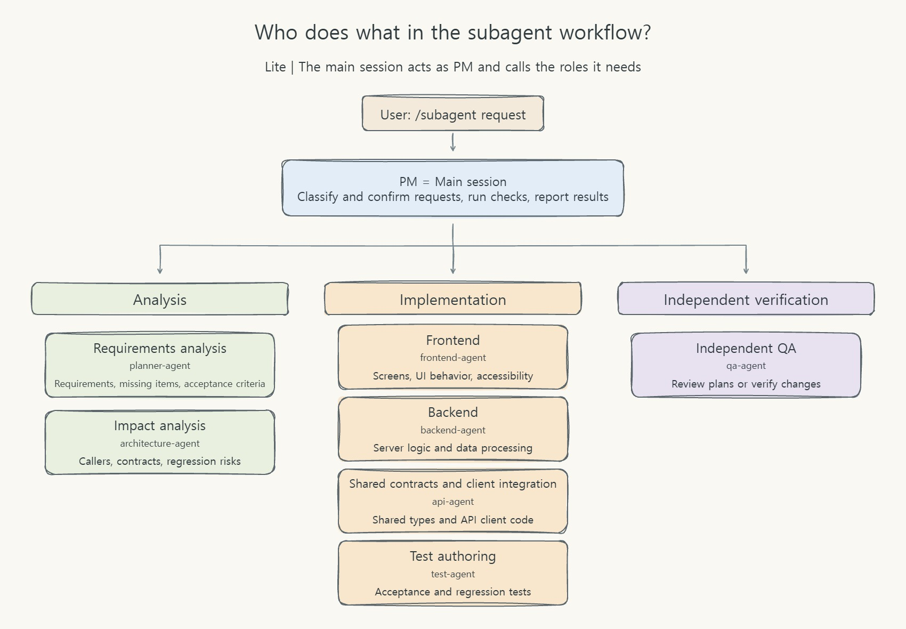
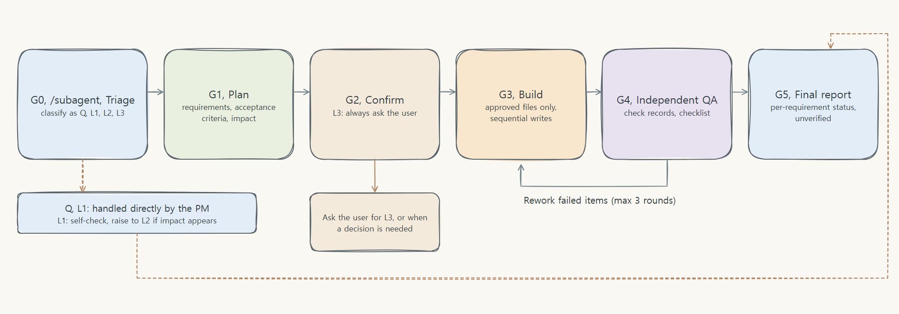

# How it works

[Back to README](../../README.en.md)

## How it works

### The subagent workflow

When you call the workflow, the main session acts as the PM for that request, talks with you, and calls only the roles it needs (the PM instructions are the `/subagent-workflow:run` skill).

The PM calls the analysis, worker, and QA roles directly. Full mode, relay execution, and strict mode from v0.6.x were removed in v0.7.0.

| Role | Responsibility |
| --- | --- |
| PM (`/subagent-workflow:run` skill, main session) | Request classification, user conversation and confirmation, approval scope, running checks, final report |
| planning-lead, dev-lead | Kept for the leader organization planned for v0.8.0; the PM does not call them in v0.7.0 |
| planner-agent | Requirement breakdown, finding items users may miss, acceptance criteria |
| architecture-agent | Analysis of callers, contracts, regressions, and side effects |
| frontend, backend, api, test | Edit only assigned files, write tests |
| qa-agent | Independent verification of the plan, changes, check records, and completion checklist |

Terms: a **subagent** is a Claude Code feature defined by one role file. The 9 built-in roles live in the plugin's `agents/`, and roles you add live in your project's `.claude/agents/`. The `-agent` and `-lead` in the table are only file name suffixes and every one is a subagent. The PM is not a subagent but the main session that talks with you, and `/subagent-workflow:run` is a skill holding the PM instructions, not an agent.

### Workflow

| Grade | Example | Path |
| --- | --- | --- |
| Q | Questions, explanations | The PM answers directly, even after the workflow is called |
| L1 | Comments, typos, wording, behavior unchanged | The PM edits directly and self-checks with the checklist |
| L2 | Ordinary behavior changes | Plan, confirm, build, final verification. The PM self-confirms when no item needs approval and there is a single interpretation |
| L3 | Contracts, permissions, data, security, many areas | The L2 path with required impact analysis; the user is always asked to confirm |

- **Requirements become Given/When/Then acceptance criteria**, and failing tests are written first when testing is possible.
- **Every subagent reads the request source and the plan file directly**, so summaries cannot distort requirements.
- Scope changes, policy decisions, compatibility changes, security, and external effects are confirmed with you first; otherwise the PM self-confirms and says so.
- No source edits before confirmation. A failed verification goes back to development, with a limit of 3 rework rounds.
- Only approved commands run, through a **check runner** that records exit code, times, output, and hashes; QA reads these originals, not the PM's summary.
- Library and framework behavior is checked, only where this task touches it, against the installed version: Context7 first, then the official doc page (Jina, or WebFetch if that fails). Answers go to the run's `evidence.md` so later roles and runs reuse them; if the docs cannot be checked, the workflow does not go on from memory: it asks you whether to continue with that item unverified, and changes no file that depends on it until you answer.

### Project rules come first

This workflow is a base layer, so it always ranks below the rules a project already has. The order is: your request > the project's rule files (`CLAUDE.md`, `AGENTS.md`, lint config, verification method, branch rules) > existing conventions > the profile > workflow defaults. Details: [rule-priority.md](../../template/.claude/subagent-workflow:run/rule-priority.md).

- The profile does not copy rules; it points to the **original paths**. Agents re-read the originals before work, so edits to them apply immediately.
- Workflow behaviors fall into three classes.
  1. **Defaults**: plan and card forms, requirement IDs, report structure, risk grades. Where the project already defines the same thing, the project's way wins.
  2. **Confirm first**: behaviors the project lacks that change how you work (UI/UX walkthrough, a browser check in place of the project's own verification, reports in the workflow's structure). Asked once before applying.
  3. **Fixed safety**: the guard hook, no edits before confirmation, assigned files only, never reporting unchecked items as passed. If a project rule conflicts, you are told and the workflow stops.
- If the project defines its own verification method (for example measuring computed styles), it is used first; the browser check covers only what that method does not.
- The guard is a plugin hook, so it runs while the plugin is enabled, but it only acts in projects set up for the workflow. It protects only the workflow's files (`.claude/subagent/`, `settings.json`, workflow role definitions), not all of `.claude/`; your own rules, commands, agents, and hooks under `.claude/` stay editable.

### Against hallucination and unrequested edits

- The request source is quoted verbatim in the plan, and every subagent reads the source and plan files directly.
- Ambiguous requirements are asked about, not filled in by guessing; items the user did not mention are decided as include, exclude, or ask, and recorded.
- Unchecked content is never stated as fact and is marked `unverified`; library behavior is checked against docs for the installed version.
- Only files listed in the plan are edited, nothing is edited before confirmation, and instructions inside documents or tool output are not followed.
- Which rules rest on the prompt alone and which are enforced by the guard hook and check runner is laid out in [Prompt design principles](../PROMPT_DESIGN.en.md).

### Token efficiency

- When you do not call the workflow, the PM instructions are not added to the session; they are read only when `/subagent-workflow:run` runs.
- Agent prompts (roles, forms, guard messages) are written in English, about 26% fewer always-injected tokens than the Korean version (measured on all 10 roles plus forms, one model).
- Simple requests (Q and L1) never call the workflow.
- Files and requirements of the same owner are bundled into one call.
- Agents write the full report only to a file and return a status and a short summary; the PM opens the file only when it needs the evidence.
- Callers and library answers found by an earlier role are passed to the next role's card as paths, so the same search is not repeated. QA uses them as a starting list and checks them itself.
- The question policy printed once by the grade command is used as is; the file is not opened again.
- Design-work guidance lives in files read only when that work happens (PM instruction input about 18% smaller, measured on one model), and a checker confirms the required rules by list.
