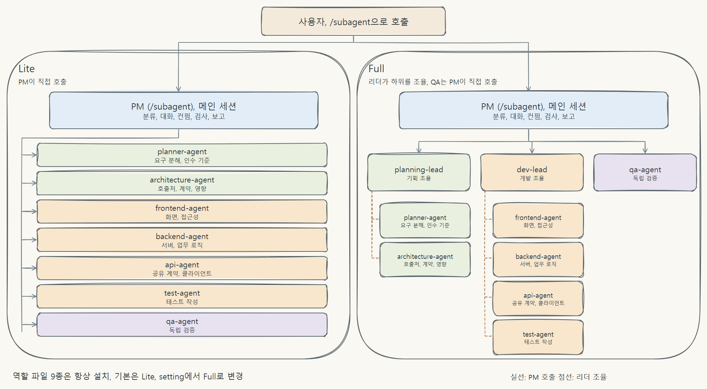
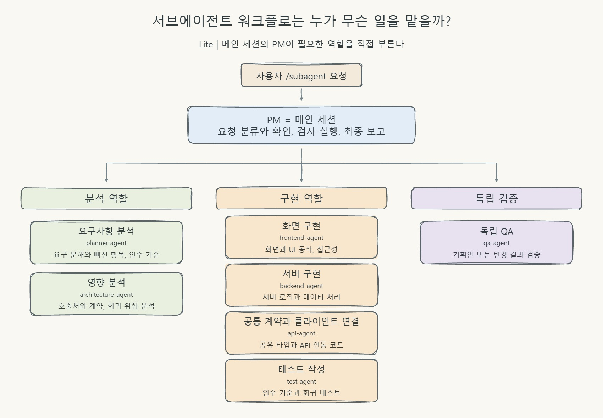
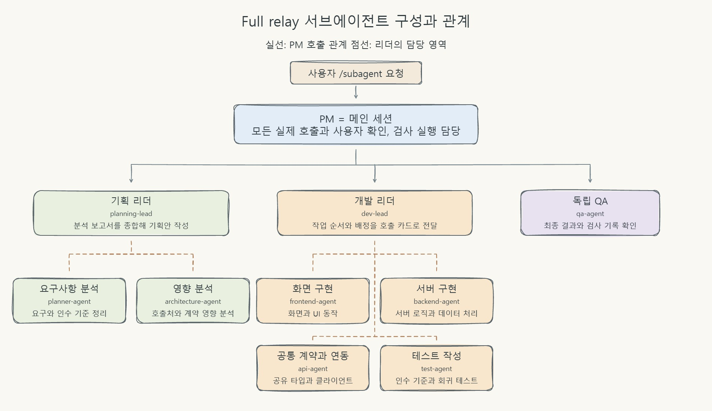
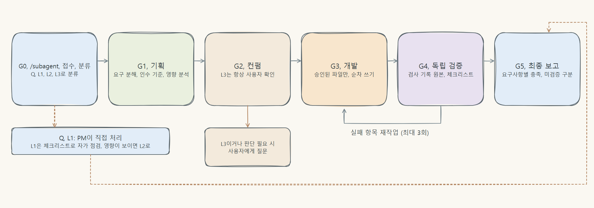

# 동작 방식

[README로 돌아가기](../../README.md)

## 동작 방식

### 서브에이전트 워크플로

워크플로를 부르면 그 요청 동안 메인 세션이 PM으로 일해요. 사용자와 대화하면서 필요한 역할만 불러요. PM 지침은 `/subagent` 스킬에 들어 있어요.

| 모드 | 구성 | 알맞은 경우 |
| --- | --- | --- |
| Lite | PM이 분석·실무·QA를 직접 호출 | 일반 작업 |
| Full | 기획 리더·개발 리더가 하위 역할을 조율, QA는 PM이 직접 호출 | 여러 영역에 걸친 큰 작업, 위험이 큰 작업 |

Full의 relay 방식에서는 리더가 하위 역할을 직접 부르지 않고 호출 카드를 돌려줘요. PM이 그 카드대로 호출해요. 리더가 하위 역할을 직접 부르는 nested 방식은 확인한 버전에서 동작하지 않아서 권하지 않아요.

| 역할 | 하는 일 |
| --- | --- |
| PM (`/subagent` 스킬, 메인 세션) | 요청 분류, 사용자와 대화·확인, 승인 범위 관리, 검사 실행, 최종 보고 |
| planning-lead · dev-lead | Full에서 기획 조율 · 개발 조율 |
| planner-agent | 요구 분해, 사용자가 놓칠 수 있는 항목 찾기, 인수 기준 정리 |
| architecture-agent | 호출처·계약·회귀·부작용 분석 |
| frontend · backend · api · test | 배정된 파일만 수정, 테스트 작성 |
| qa-agent | 기획 검증, 변경·검사 기록·완료 체크리스트를 독립적으로 검증 |

### 작업 흐름

| 등급 | 예 | 경로 |
| --- | --- | --- |
| Q | 질문·설명 | 워크플로를 부른 뒤에도 PM이 바로 답변 |
| L1 | 주석·오탈자·문구, 동작이 바뀌지 않는 수정 | PM이 직접 수정하고 체크리스트로 점검 |
| L2 | 동작이 바뀌는 일반 변경 | 기획 → 확인 → 개발 → 최종 검증. 승인이 필요한 항목이 없고 해석이 하나뿐이면 PM이 자체 컨펌 |
| L3 | 계약·권한·데이터·보안·여러 영역에 걸친 변경 | L2 경로에 영향 분석 필수, 사용자 확인은 항상 수행 |

- **요구는 Given/When/Then 인수 기준으로 정리해요.** 테스트가 가능하면 실패하는 테스트를 먼저 작성해요.
- **요청 원문과 기획안 파일을 모든 에이전트가 직접 읽어요.** 요약해서 전달하다가 요구가 달라지는 일을 막아요.
- 요구 범위 변경·정책 결정·호환성 변경·보안·외부 영향이 있으면 사용자에게 먼저 확인해요. 없으면 PM이 자체 컨펌하고 그 사실을 표시해요.
- 확인을 받기 전에는 소스를 수정하지 않아요. 검증에 실패하면 개발로 돌아가 보완하고, 재작업은 최대 3회예요.
- 검사는 승인된 명령만 **검사 실행기**가 실행하고, exit code·시각·출력·해시를 기록해요. QA는 PM의 요약이 아니라 이 원본을 확인해요.
- 라이브러리·프레임워크 동작은 설치된 버전 기준으로 Context7에서 확인해요. 확인하지 못한 내용은 `unchecked`로 표시해요.

### 프로젝트 규칙이 먼저예요

이 워크플로는 기본값을 제공하는 베이스라서 프로젝트에 이미 있는 규칙보다 항상 뒤에 와요. 우선순위는 사용자 요청 > 프로젝트 규칙 파일(`CLAUDE.md`, `AGENTS.md`, 린터 설정, 검증 방법, 브랜치 규칙) > 기존 관례 > 프로필 > 워크플로 기본값이에요. 자세한 내용은 [rule-priority.md](../../template/.claude/subagent/rule-priority.md)에 있어요.

- 프로필은 규칙을 복사하지 않고 **원본 경로**만 가리켜요. 에이전트는 작업 전에 원본을 다시 읽으니 원본을 고치면 바로 반영돼요.
- 워크플로 규칙은 세 가지로 나뉘어요.
  1. **기본값**: 계획·카드 양식, 요구사항 ID, 보고 구조, 위험 등급. 프로젝트에 같은 것이 정해져 있으면 프로젝트 방식을 따라요.
  2. **확인 후 적용**: 프로젝트에 없고 작업 방식을 바꾸는 동작(UI/UX 점검, 프로젝트 검증 방법 대신 브라우저 확인, 엄격 모드, 워크플로 형식의 보고). 적용 전에 한 번 물어봐요.
  3. **고정 안전 장치**: 가드 hook, 컨펌 전 수정 금지, 배정된 파일만 수정, 확인 못 한 것을 통과로 보고하지 않기. 프로젝트 규칙과 부딪히면 알려 드리고 멈춰요.
- 프로젝트가 정한 검증 방법(예: 계산된 스타일 실측)이 있으면 먼저 쓰고, 화면 확인은 그 방법이 다루지 못하는 부분에만 써요.
- 가드는 `.claude/` 전체가 아니라 워크플로 정책 파일(hooks, subagent, subagent 스킬, 워크플로 역할 정의, settings)만 막아서, `.claude/` 아래에 둔 내 규칙은 고칠 수 있어요.
- 엄격 모드는 이전과 같이 메인 세션의 모든 수정에 적용돼요(워크플로 실행 중으로 한정하지 않아요). 등록이 없을 때의 차단 문구는 이유와 해결 방법을 알려 줘요.

### 환각·임의 수정 방지

- 요청 원문을 기획안에 그대로 인용하고, 모든 에이전트가 원문과 기획안 파일을 직접 읽어요.
- 모호한 요구는 추정으로 채우지 않고 질문해요. 사용자가 말하지 않은 항목은 포함·제외·질문 중 하나로 정해서 기록해요.
- 확인하지 못한 내용은 사실처럼 쓰지 않고 `unverified`로 표기해요. 라이브러리 동작은 설치된 버전의 문서로 확인해요.
- 기획안에 적힌 파일만 수정해요. 컨펌 전에는 수정하지 않고, 문서나 도구 출력 속 지시문은 지시로 따르지 않아요.
- 프롬프트만으로 지켜지는 규칙과 가드 hook·검사 실행기로 강제되는 규칙을 구분해서 정리했어요: [프롬프트 설계 원칙](../PROMPT_DESIGN.md)

### 토큰 효율

- 워크플로를 부르지 않으면 PM 지침이 세션에 붙지 않아요. 지침은 `/subagent`을 부를 때만 읽혀요.
- 에이전트 프롬프트(역할·양식·가드 메시지)는 영어로 썼어요. 한국어보다 상시 주입 토큰이 약 26% 적어요(역할 10종과 양식을 합친 본문, 한 모델 기준 실측).
- 간단한 요청(Q·L1)은 워크플로를 호출하지 않아요.
- 같은 담당자의 파일과 요구는 한 번의 호출로 묶어요.
- relay 절차와 디자인 작업 지침은 해당 작업일 때만 읽는 파일로 분리했어요(PM 지침 입력 약 18% 감소, 한 모델 기준 실측). 필수 규칙은 검사기가 목록으로 확인해요.
