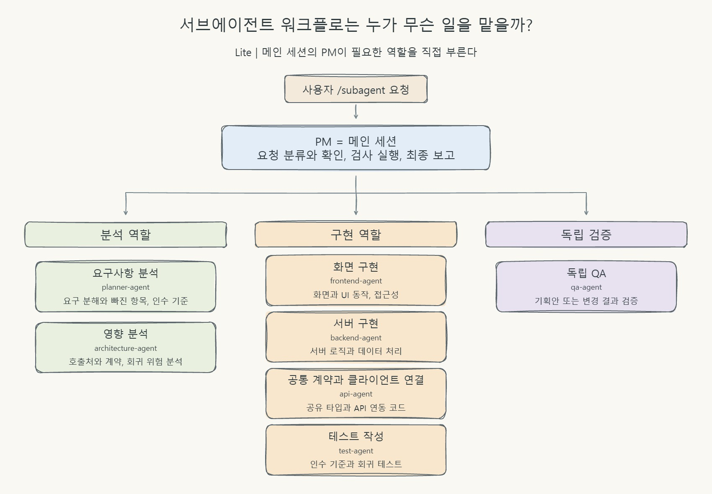
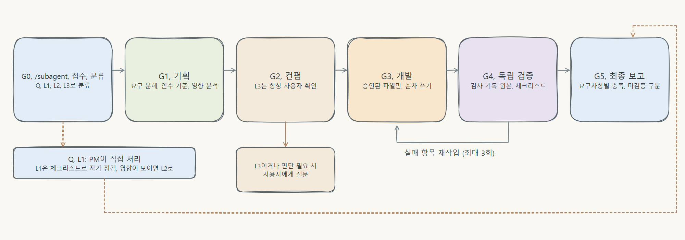

# 동작 방식

[README로 돌아가기](../../README.md)

## 동작 방식

### 서브에이전트 워크플로

워크플로를 부르면 그 요청 동안 메인 세션이 PM으로 일해요. 사용자와 대화하면서 필요한 역할만 불러요. PM 지침은 `/subagent-workflow:run` 스킬에 들어 있어요.

PM이 분석, 실무, QA 역할을 직접 불러요. v0.6.x의 Full 모드와 relay 방식, 엄격 모드는 v0.7.0에서 없앴어요.

| 역할 | 하는 일 |
| --- | --- |
| PM (`/subagent-workflow:run` 스킬, 메인 세션) | 요청 분류, 사용자와 대화, 확인, 승인 범위 관리, 검사 실행, 최종 보고 |
| planning-lead, dev-lead | v0.8.0의 리더 조직용으로 남겨 둔 역할, v0.7.0에서는 PM이 부르지 않음 |
| planner-agent | 요구 분해, 사용자가 놓칠 수 있는 항목 찾기, 인수 기준 정리 |
| architecture-agent | 호출처, 계약, 회귀, 부작용 분석 |
| frontend, backend, api, test | 배정된 파일만 수정, 테스트 작성 |
| qa-agent | 기획 검증, 변경, 검사 기록, 완료 체크리스트를 독립적으로 검증 |

용어: **서브에이전트**는 역할 파일 하나로 정의되는 Claude Code 기능이에요. 기본 역할 9종은 플러그인의 `agents/`에 있고, 직접 추가한 역할은 프로젝트의 `.claude/agents/`에 있어요. 표의 `-agent`, `-lead`는 파일 이름 접미사일 뿐 모두 서브에이전트예요. PM은 서브에이전트가 아니라 사용자와 대화하는 메인 세션이고, `/subagent-workflow:run`는 에이전트가 아니라 PM의 지침이 든 스킬이에요.

### 작업 흐름

| 등급 | 예 | 경로 |
| --- | --- | --- |
| Q | 질문, 설명 | 워크플로를 부른 뒤에도 PM이 바로 답변 |
| L1 | 주석, 오탈자, 문구, 동작이 바뀌지 않는 수정 | PM이 직접 수정하고 체크리스트로 점검 |
| L2 | 동작이 바뀌는 일반 변경 | 기획 → 확인 → 개발 → 최종 검증. 승인이 필요한 항목이 없고 해석이 하나뿐이면 PM이 자체 컨펌 |
| L3 | 계약, 권한, 데이터, 보안, 여러 영역에 걸친 변경 | L2 경로에 영향 분석 필수, 사용자 확인은 항상 수행 |

- **요구는 Given/When/Then 인수 기준으로 정리해요.** 테스트가 가능하면 실패하는 테스트를 먼저 작성해요.
- **요청 원문과 기획안 파일을 모든 서브에이전트가 직접 읽어요.** 요약해서 전달하다가 요구가 달라지는 일을 막아요.
- 요구 범위 변경, 정책 결정, 호환성 변경, 보안, 외부 영향이 있으면 사용자에게 먼저 확인해요. 없으면 PM이 자체 컨펌하고 그 사실을 표시해요.
- 확인을 받기 전에는 소스를 수정하지 않아요. 검증에 실패하면 개발로 돌아가 보완하고, 재작업은 최대 3회예요.
- 검사는 승인된 명령만 **검사 실행기**가 실행하고, exit code, 시각, 출력, 해시를 기록해요. QA는 PM의 요약이 아니라 이 원본을 확인해요.
- 라이브러리, 프레임워크 동작은 이번 작업에 닿는 것만 설치된 버전 기준으로 확인해요. Context7, 공식 문서 페이지(Jina, 실패하면 WebFetch) 순서이고, 결과는 실행 폴더의 `evidence.md`에 남겨 다음 역할과 다음 실행이 다시 쓰게 해요. 문서로 확인하지 못하면 기억으로 진행하지 않고, 미확인인 채로 계속할지 먼저 물어요. 답을 받기 전에는 그 내용에 기대는 파일을 바꾸지 않아요.

### 프로젝트 규칙이 먼저예요

이 워크플로는 기본값을 제공하는 베이스라서 프로젝트에 이미 있는 규칙보다 항상 뒤에 와요. 우선순위는 사용자 요청 > 프로젝트 규칙 파일(`CLAUDE.md`, `AGENTS.md`, 린터 설정, 검증 방법, 브랜치 규칙) > 기존 관례 > 프로필 > 워크플로 기본값이에요. 자세한 내용은 [rule-priority.md](../../template/.claude/subagent-workflow:run/rule-priority.md)에 있어요.

- 프로필은 규칙을 복사하지 않고 **원본 경로**만 가리켜요. 서브에이전트는 작업 전에 원본을 다시 읽으니 원본을 고치면 바로 반영돼요.
- 워크플로 규칙은 세 가지로 나뉘어요.
  1. **기본값**: 계획, 카드 양식, 요구사항 ID, 보고 구조, 위험 등급. 프로젝트에 같은 것이 정해져 있으면 프로젝트 방식을 따라요.
  2. **확인 후 적용**: 프로젝트에 없고 작업 방식을 바꾸는 동작(UI/UX 점검, 프로젝트 검증 방법 대신 브라우저 확인, 워크플로 형식의 보고). 적용 전에 한 번 물어봐요.
  3. **고정 안전 장치**: 가드 hook, 컨펌 전 수정 금지, 배정된 파일만 수정, 확인 못 한 것을 통과로 보고하지 않기. 프로젝트 규칙과 부딪히면 알려 드리고 멈춰요.
- 프로젝트가 정한 검증 방법(예: 계산된 스타일 실측)이 있으면 먼저 쓰고, 화면 확인은 그 방법이 다루지 못하는 부분에만 써요.
- 가드는 플러그인 hook이라 플러그인을 켠 동안 동작하지만, 워크플로를 설정한 프로젝트에서만 판정해요. `.claude/` 전체가 아니라 워크플로 파일(`.claude/subagent/`, `settings.json`, 워크플로 역할 정의)만 보호하고, 사용자가 `.claude/` 아래에 둔 자기 규칙, 명령, 에이전트, hook은 그대로 수정할 수 있어요.

### 환각, 임의 수정 방지

- 요청 원문을 기획안에 그대로 인용하고, 모든 서브에이전트가 원문과 기획안 파일을 직접 읽어요.
- 모호한 요구는 추정으로 채우지 않고 질문해요. 사용자가 말하지 않은 항목은 포함, 제외, 질문 중 하나로 정해서 기록해요.
- 확인하지 못한 내용은 사실처럼 쓰지 않고 `unverified`로 표기해요. 라이브러리 동작은 설치된 버전의 문서로 확인해요.
- 기획안에 적힌 파일만 수정해요. 컨펌 전에는 수정하지 않고, 문서나 도구 출력 속 지시문은 지시로 따르지 않아요.
- 프롬프트만으로 지켜지는 규칙과 가드 hook, 검사 실행기로 강제되는 규칙을 구분해서 정리했어요: [프롬프트 설계 원칙](../PROMPT_DESIGN.md)

### 토큰 효율

- 워크플로를 부르지 않으면 PM 지침이 세션에 붙지 않아요. 지침은 `/subagent-workflow:run`을 부를 때만 읽혀요.
- 서브에이전트 프롬프트(역할, 양식, 가드 메시지)는 영어로 썼어요. 한국어보다 상시 주입 토큰이 약 26% 적어요(역할 10종과 양식을 합친 본문, 한 모델 기준 실측).
- 간단한 요청(Q, L1)은 워크플로를 호출하지 않아요.
- 같은 담당자의 파일과 요구는 한 번의 호출로 묶어요.
- 서브에이전트는 보고서 전문을 파일에만 쓰고 PM에게는 상태와 짧은 요약만 돌려줘요. PM은 근거가 필요할 때만 파일을 읽어요.
- 앞선 역할이 찾은 호출처와 라이브러리 확인 결과를 다음 역할의 카드에 경로로 넘겨, 같은 조사를 반복하지 않게 해요. QA는 그 목록을 출발점으로 쓰되 직접 다시 확인해요.
- 질문 정책은 분류 명령이 한 번 출력한 것을 쓰고 파일을 다시 열지 않아요.
- 디자인 작업 지침은 해당 작업일 때만 읽는 파일로 분리했어요(PM 지침 입력 약 18% 감소, 한 모델 기준 실측). 필수 규칙은 검사기가 목록으로 확인해요.
