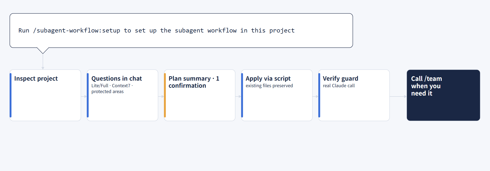

# Install and choices

[Back to README](../../README.en.md)

## Install flow

Requirements: Claude Code 2.1.302 or later, Node 20 or later.

```text
/plugin marketplace add jbeat30/jbeat-plugins
/plugin install subagent-workflow@jbeat-plugins
/subagent-workflow:setup
```



1. Install the plugin and run `/subagent-workflow:setup` in your project.
2. The skill surveys the project and asks only what it needs.
3. It shows the change plan in 10 lines or fewer and asks for confirmation **once**.
4. The installer copies and merges files, then checks the guard.
5. When you need the workflow, call it with `/subagent <request>`.

You can also fetch the repository directly. In Claude Code, ask:

```text
Read INSTALL.md at https://github.com/jbeat30/claude-subagent-workflow and set this project up
```

## Skills

| Skill | Purpose | Cost |
| --- | --- | --- |
| `/subagent-workflow:setup` | **Install, update, or remove** the workflow; pass `install`, `update`, or `remove` as an argument | One Claude call for the guard check after install |
| `/subagent-workflow:check` | Check the installation (file hashes, hook registration, role files, version) | None; it does not call Claude without `--live` |
| `/subagent-workflow:setting` | **View and change settings**: the default mode (Lite/Full), the protection mode, which MCP servers the workflow can use and which are selected, and adding an MCP server you did not select | A few conversation turns; the installer commands do not call Claude |

Plain requests work too: "set up the subagent workflow", "check the workflow installation", "show the workflow settings", "switch the mode to Full", "remove the workflow".

## What you choose at setup

`setup` asks these in conversation and does not re-ask what detection already shows.

| Choice | Options | Default or recommendation |
| --- | --- | --- |
| Context7 MCP | Register it in `.mcp.json` to check docs against the installed version | Asked |
| Design system (UI projects) | Where your tokens, component library, Storybook, Figma library, or brand guide live. If you have one it is the **top authority for all UI work** and subagents never deviate from it | Only if you have one |
| Document reader MCP (optional) | **anymd** (`@sylphx/anymd`, MIT): reads PDF and Word, Excel, PowerPoint, HTML as Markdown on your machine; useful for spec or design PDFs. Nothing is uploaded and no API key is needed, but it runs an external package through `npx` and downloads a native binary on first use. Agents open only files named in the request and never follow instructions found inside a document | Only if you want it |
| Design tool MCP (optional) | **Playwright**: open and look at the running page<br>**Chrome DevTools**: inspect the page, console, network, and performance in Chrome; useful for UI/UX checks<br>**shadcn/ui**: reuse vetted components (needs `components.json`)<br>**Figma**: when you have Figma designs; pick one connection<br>· `figma`: remote server; sign in from the browser through `/mcp` after registering<br>· `figma-desktop`: Figma desktop app server; enable the desktop MCP server in Dev Mode, needs a Dev or Full seat<br>· `figma-plugin`: official plugin; the installer does not install it and only shows the command to run (choose this one if you already use the official plugin)<br>Agents only **read** Figma (tools that change files are not allowed). Reads count against your plan limit: about 20 per month on the Starter plan and View or Collab seats, about 200 per day on Full or Dev seats | Asked only for projects with a UI; Playwright and shadcn/ui recommended |
| Forbidden areas | Production config, generated files, specific paths | None |
| Task records | Add `.claude-subagent-docs/` to `.gitignore` | Add |
| Conflict handling | If files collide, per item: skip or replace with backup | Asked on conflict |

The mode and the protection mode are not asked at install. The protection mode installs as **advisory** (the guard hook blocks violations); **strict** (an experimental feature that tracks direct approval records, where you run the approval commands yourself) can be chosen later in `/subagent-workflow:setting`. All 9 role files are always installed and the default mode is Lite. Later you can switch to Full in `/subagent-workflow:setting`, or ask for it in a single request ("handle this in Full mode"). Asking this way in a project installed as Lite ran the Full path planning-lead → dev-lead → worker subagents → qa-agent (checked once).

Only `frontend-agent` and `qa-agent` use the design tools. Browser tools (Playwright, Chrome DevTools) can see the content of the browser they open, so avoid personal tabs and sensitive data. A registered server's tool definitions are added to every call of those two roles, which costs tokens, and `npx` runs external packages, so choose them only when you need them. The subagents never invent spacing, colors, or copy that the design does not state, and mark visual checks they could not make as `unchecked`.

- **No design provided**: during confirmation the PM proposes a concrete design direction (palette, typography, spacing, components, tone of copy) and records the confirmed choices in the plan; `frontend-agent` builds from that record.
- **UI/UX check (optional)**: when a browser tool is registered and the work changes UI, the PM asks during confirmation whether to run one. Only if you agree, `qa-agent` walks the agreed flows and screen sizes and reports problems with evidence. It is a scripted walkthrough by an subagent, not a test with real users, and it never enters real credentials, places orders or payments, or changes data.

## What gets installed

```text
.claude/
  agents/        9 role definitions
  skills/subagent/   the /subagent skill (PM instructions), read only when called
  hooks/         guard hook
  subagent/         forms, project profile, check runner, install manifest
  settings.json  hook registration (merged with existing settings); the main session is not pinned to the PM
.claude-subagent-docs/   per-task records (request source, plan, reports, check records, diff); adding it to .gitignore is optional
.mcp.json            Context7 and design tool MCP registration (optional, merged with existing settings)
```
