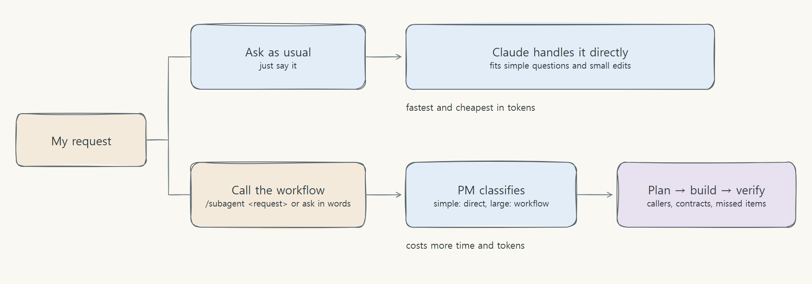

# Using it after install

[Back to README](../../README.en.md)

## Using it after install

The workflow starts only when you call it; otherwise you talk to Claude as usual.



- `/subagent <request>`: starts the workflow for sure.
- In words: "solve this with the subagent workflow" or "work on this as pm-agent" are recognized too (the model decides, so it can occasionally miss; use `/subagent` then. Claude may ask for permission to run the skill. In a non-interactive check the skill did not run without that permission; the interactive screen has not been checked).
- For a simple question or a small edit, asking Claude directly is faster and cheaper than calling the workflow.

```text
/subagent Add a show/hide password toggle to the existing login screen. Follow the current UI rules.
```

```text
Solve this with the subagent workflow: add shipping status to the order API response and wire it to the screen. Start by laying out the contract and impact.
```

```text
Explain what this function does.
```

### When to call the workflow

| Call the workflow | Just ask directly |
| --- | --- |
| Changing a function's return shape or an API contract so several callers must change | Explaining code, questions |
| Adding a feature where unstated requirements (validation, error handling) are easy to miss | Typos, comments, wording |
| Changes to data structures, permissions, or security where the impact has to be worked out first | A small edit to a single file |

In the evaluation the workflow appeared to help on changes with hidden callers and on tasks with unstated requirements. There are too few repeated runs to be sure. Details are in the [results and limits](../verification/results/hard-task-comparison.md) (Korean).

A request like the last one, without calling the workflow, is answered by regular Claude. The PM answers and asks questions in the language you write in.
