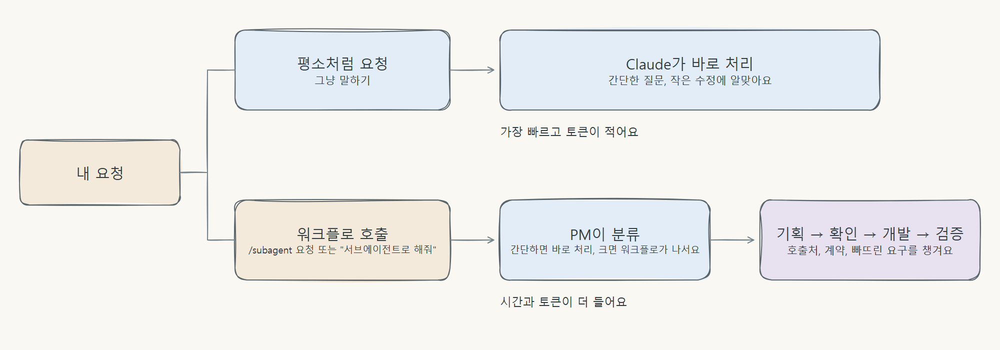

# 설치 후 사용

[README로 돌아가기](../../README.md)

## 설치 후 사용

워크플로는 사용자가 부를 때만 켜져요. 부르지 않으면 평소처럼 Claude와 대화해요.



- `/subagent 요청 내용`: 확실하게 워크플로로 시작
- 말로 부르기: "서브에이전트 워크플로로 해결해 줘", "pm-agent로 작업해 줘" 같은 표현도 알아들어요. 모델이 판단하는 방식이라 가끔 놓칠 수 있고, 그때는 `/subagent`을 쓰세요. 스킬 실행을 허용할지 묻는 창이 뜰 수 있어요. 비대화형 점검에서는 허용하지 않으면 실행되지 않았고, 대화형 화면은 아직 확인하지 못했어요.
- 간단한 질문이나 작은 수정은 워크플로를 부르지 않고 평소처럼 Claude에게 직접 요청하는 편이 빠르고 토큰도 적게 들어요.

```text
/subagent 기존 로그인 화면에 비밀번호 표시 전환을 추가해줘. 현재 UI 규칙을 따라줘.
```

```text
서브에이전트 워크플로로 해결해 줘: 주문 API 응답에 배송 상태를 추가하고 화면에 연결해줘. 계약과 영향 범위부터 정리해줘.
```

```text
이 함수가 어떤 역할인지 설명해줘.
```

마지막 예처럼 워크플로를 부르지 않은 요청은 평소 Claude가 답해요. PM의 응답과 질문은 사용자가 쓰는 언어를 따라요.

### 언제 워크플로를 부르면 좋을까요

| 워크플로를 불러 보세요 | 그냥 요청하세요 |
| --- | --- |
| 함수 반환 형식이나 API 계약을 바꿔서 호출처를 여러 곳 고쳐야 할 때 | 코드 설명, 질문 |
| 말하지 않은 요구(검증, 오류 처리 등)를 빠뜨리기 쉬운 기능 추가 | 오탈자, 주석, 문구 수정 |
| 데이터 구조·권한·보안처럼 영향 범위를 먼저 따져야 하는 변경 | 파일 하나를 고치는 작은 수정 |

평가에서 워크플로가 도움이 된 것으로 보인 경우는 호출처가 숨어 있는 변경과 말하지 않은 요구가 있는 작업이었어요. 아직 반복 측정이 부족해서 확정은 아니에요. 자세한 내용은 [평가 결과와 한계](../verification/results/hard-task-comparison.md)에 있어요.
